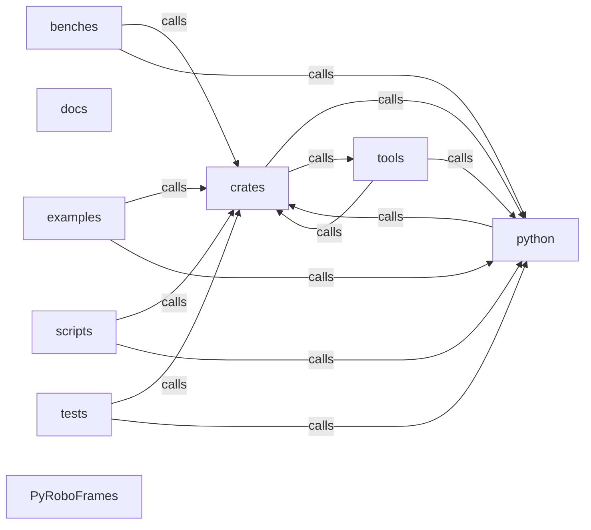

_Generated by CodeAtlas._

## Details

Architecture map of PyRoboFrames.

### benches

Owns 16 symbols across 5 file(s).

**Related Classes/Methods:** _None_

**Source Files:**

- `benches/codec_benchmark.py`
  - `benches.codec_benchmark.benchmark_codec`
  - `benches.codec_benchmark.create_synthetic_features`
  - `benches.codec_benchmark.main`
  - `benches.codec_benchmark.measure_dir_size`
- `benches/codec_comparison.py`
  - `benches.codec_comparison.benchmark_codec`
  - `benches.codec_comparison.create_synthetic_features`
  - `benches.codec_comparison.main`
  - `benches.codec_comparison.measure_dir_size_mb`
  - `benches.codec_comparison.print_table`
- `benches/nvidia_benchmark.py`
  - `benches.nvidia_benchmark.main`
  - `benches.nvidia_benchmark.make_dataset`
  - `benches.nvidia_benchmark.time_epoch`
- `benches/throughput.py`
  - `benches.throughput.available_outputs`
  - `benches.throughput.main`
  - `benches.throughput.make_dataset`
  - `benches.throughput.time_epoch`

### crates

Owns 0 symbols across 0 file(s).

**Related Classes/Methods:** _None_

### docs

Owns 0 symbols across 16 file(s).

**Related Classes/Methods:** _None_

### examples

Owns 28 symbols across 4 file(s).

**Related Classes/Methods:** _None_

**Source Files:**

- `examples/humanoid_multimodal_fusion.py`
  - `examples.humanoid_multimodal_fusion.HumanoidDataLoader`
  - `examples.humanoid_multimodal_fusion.HumanoidDataLoader.__init__`
  - `examples.humanoid_multimodal_fusion.HumanoidDataLoader.get_multimodal_batch`
  - `examples.humanoid_multimodal_fusion.create_synthetic_humanoid_dataset`
  - `examples.humanoid_multimodal_fusion.demonstrate_sensor_fusion`
  - `examples.humanoid_multimodal_fusion.main`
  - `examples.humanoid_multimodal_fusion.train_step_example`
- `examples/mcp_dataset_tools.py`
  - `examples.mcp_dataset_tools.analyze_episode`
  - `examples.mcp_dataset_tools.benchmark_loader`
  - `examples.mcp_dataset_tools.compare_datasets`
  - `examples.mcp_dataset_tools.get_dataset_summary`
  - `examples.mcp_dataset_tools.process_dataset_batch`
  - `examples.mcp_dataset_tools.validate_dataset`
- `examples/performance_tuning.py`
  - `examples.performance_tuning.configure_cache_for_edge`
  - `examples.performance_tuning.configure_cache_for_exploration`
  - `examples.performance_tuning.configure_cache_for_training`
  - `examples.performance_tuning.find_optimal_batch_size`
  - `examples.performance_tuning.generate_performance_report`
  - `examples.performance_tuning.measure_prefetch_impact`
  - `examples.performance_tuning.monitor_memory_usage`
  - `examples.performance_tuning.profile_loader_performance`
- `examples/robotdog_proprioceptive_learning.py`
  - `examples.robotdog_proprioceptive_learning.best_practices`
  - `examples.robotdog_proprioceptive_learning.example_imu_based_gait_control`
  - `examples.robotdog_proprioceptive_learning.example_joint_space_policy`
  - `examples.robotdog_proprioceptive_learning.example_multi_modality_without_vision`
  - `examples.robotdog_proprioceptive_learning.example_real_time_inference`
  - `examples.robotdog_proprioceptive_learning.performance_comparison`
  - `examples.robotdog_proprioceptive_learning.when_to_use_p0`

### python

Owns 0 symbols across 0 file(s).

**Related Classes/Methods:** _None_

### scripts

Owns 11 symbols across 2 file(s).

**Related Classes/Methods:** _None_

**Source Files:**

- `scripts/verify_gpu_support.py`
  - `scripts.verify_gpu_support.benchmark_transforms`
  - `scripts.verify_gpu_support.check`
  - `scripts.verify_gpu_support.check_cuda`
  - `scripts.verify_gpu_support.check_cvcuda`
  - `scripts.verify_gpu_support.check_ffmpeg`
  - `scripts.verify_gpu_support.check_nvidia_smi`
  - `scripts.verify_gpu_support.check_pyroboframes`
  - `scripts.verify_gpu_support.check_transform_backends`
  - `scripts.verify_gpu_support.main`
  - `scripts.verify_gpu_support.run_command`
  - `scripts.verify_gpu_support.section`

### tests

Owns 405 symbols across 29 file(s).

**Related Classes/Methods:** _None_

**Source Files:**

- `tests/test_backend_parity.py`
  - `tests.test_backend_parity._to_numpy`
  - `tests.test_backend_parity.test_default_framework_mapping`
  - `tests.test_backend_parity.test_same_script_conformance_cpu_vs_auto`
  - `tests.test_backend_parity.test_same_script_conformance_cpu_vs_auto.shapes`
  - `tests.test_backend_parity.test_to_backend_cpu_is_identity`
  - `tests.test_backend_parity.test_to_backend_mlx_roundtrip`
  - `tests.test_backend_parity.test_transform_backend_fallback_chain`
- `tests/test_caching.py`
  - `tests.test_caching.test_episode_cache_arrays_have_correct_shape`
  - `tests.test_caching.test_episode_cache_clear`
  - `tests.test_caching.test_episode_cache_lru_eviction`
  - `tests.test_caching.test_episode_cache_prefetch_nonblocking`
  - `tests.test_caching.test_episode_cache_returns_consistent_arrays`
- `tests/test_calibration.py`
  - `tests.test_calibration.test_camera_calibration_creation`
  - `tests.test_calibration.test_camera_calibration_project_world_point`
  - `tests.test_calibration.test_camera_calibration_repr`
  - `tests.test_calibration.test_camera_calibration_unproject_to_world_ray`
  - `tests.test_calibration.test_camera_intrinsics_creation`
  - `tests.test_calibration.test_camera_intrinsics_k_matrix`
  - `tests.test_calibration.test_camera_intrinsics_project`
  - `tests.test_calibration.test_camera_intrinsics_project_behind_camera`
  - `tests.test_calibration.test_camera_intrinsics_repr`
  - `tests.test_calibration.test_camera_intrinsics_unproject_direction`
  - `tests.test_calibration.test_multi_camera_setup`
  - `tests.test_calibration.test_projection_back_to_world`
- `tests/test_codeatlas_adapter.py`
  - `tests.test_codeatlas_adapter._run`
  - `tests.test_codeatlas_adapter.test_check_reports_the_embedded_engine_available`
  - `tests.test_codeatlas_adapter.test_diagnose_summarises_the_architecture_map`
  - `tests.test_codeatlas_adapter.test_explain_reports_an_unknown_node_as_an_error`
  - `tests.test_codeatlas_adapter.test_god_nodes_are_ranked_by_degree`
- `tests/test_codecs.py`
  - `tests.test_codecs.test_codec_backwards_compatibility`
  - `tests.test_codecs.test_load_dataset_with_codec_metadata`
  - `tests.test_codecs.test_write_rejects_invalid_codec`
  - `tests.test_codecs.test_write_with_av1_codec`
  - `tests.test_codecs.test_write_with_default_codec`
  - `tests.test_codecs.test_write_with_hevc_codec`
- `tests/test_dataframe.py`
  - `tests.test_dataframe._make_converted`
  - `tests.test_dataframe.test_align_as_of_join`
  - `tests.test_dataframe.test_align_tolerance_drops_stale_matches`
  - `tests.test_dataframe.test_from_mcap_end_to_end`
  - `tests.test_dataframe.test_load_and_per_topic_access`
  - `tests.test_dataframe.test_resample_nearest`
  - `tests.test_dataframe.test_resample_previous_and_linear`
  - `tests.test_dataframe.test_slice_filters_every_topic`
- `tests/test_dataset_loaders.py`
  - `tests.test_dataset_loaders.TestCameraCalibration`
  - `tests.test_dataset_loaders.TestCameraCalibration.test_calibration_creation`
  - `tests.test_dataset_loaders.TestCameraCalibration.test_calibration_with_distortion`
  - `tests.test_dataset_loaders.TestFrameMetadata`
  - `tests.test_dataset_loaders.TestFrameMetadata.test_frame_metadata_creation`
  - `tests.test_dataset_loaders.TestKITTIDatasetLoader`
  - `tests.test_dataset_loaders.TestKITTIDatasetLoader.test_kitti_default_calibration`
  - `tests.test_dataset_loaders.TestKITTIDatasetLoader.test_kitti_frame_loading`
  - `tests.test_dataset_loaders.TestKITTIDatasetLoader.test_kitti_get_nonexistent_sequence`
  - `tests.test_dataset_loaders.TestKITTIDatasetLoader.test_kitti_initialization`
  - `tests.test_dataset_loaders.TestKITTIDatasetLoader.test_kitti_testing_split`
  - `tests.test_dataset_loaders.TestNuScenesDatasetLoader`
  - `tests.test_dataset_loaders.TestNuScenesDatasetLoader.test_nuscenes_camera_calibration`
  - `tests.test_dataset_loaders.TestNuScenesDatasetLoader.test_nuscenes_default_calibration`
  - `tests.test_dataset_loaders.TestNuScenesDatasetLoader.test_nuscenes_frame_loading`
  - `tests.test_dataset_loaders.TestNuScenesDatasetLoader.test_nuscenes_initialization`
  - `tests.test_dataset_loaders.TestWaymoDatasetLoader`
  - `tests.test_dataset_loaders.TestWaymoDatasetLoader.test_waymo_default_calibration`
  - `tests.test_dataset_loaders.TestWaymoDatasetLoader.test_waymo_frame_loading_nonexistent`
  - `tests.test_dataset_loaders.TestWaymoDatasetLoader.test_waymo_get_nonexistent_scene`
  - `tests.test_dataset_loaders.TestWaymoDatasetLoader.test_waymo_initialization`
- `tests/test_depth.py`
  - `tests.test_depth.test_empty_xyz_file`
  - `tests.test_depth.test_load_pcd_point_cloud`
  - `tests.test_depth.test_load_ply_point_cloud`
  - `tests.test_depth.test_load_xyz_point_cloud`
  - `tests.test_depth.test_load_xyz_with_comments`
  - `tests.test_depth.test_point_cloud_is_empty_property`
  - `tests.test_depth.test_point_cloud_repr`
  - `tests.test_depth.test_rejects_unsupported_format`
- `tests/test_depth_io.py`
  - `tests.test_depth_io.test_depth_map_grid_structure`
  - `tests.test_depth_io.test_downsample_point_cloud`
  - `tests.test_depth_io.test_downsample_point_cloud_invalid_factor`
  - `tests.test_depth_io.test_filter_point_cloud`
  - `tests.test_depth_io.test_filter_point_cloud_empty`
  - `tests.test_depth_io.test_load_point_cloud_from_depth_map`
  - `tests.test_depth_io.test_load_point_cloud_from_numpy_hwx3`
  - `tests.test_depth_io.test_load_point_cloud_from_numpy_invalid_shape`
  - `tests.test_depth_io.test_load_point_cloud_from_numpy_nx3`
  - `tests.test_depth_io.test_round_trip_numpy_to_cloud`
- `tests/test_distributed.py`
  - `tests.test_distributed.test_ray_distributed_loader_import`
  - `tests.test_distributed.test_ray_import_error_without_ray`
  - `tests.test_distributed.test_ray_import_error_without_ray._block_ray`
  - `tests.test_distributed.test_remote_dataset_from_s3_constructs`
  - `tests.test_distributed.test_remote_dataset_import_error_without_fsspec`
  - `tests.test_distributed.test_remote_dataset_import_error_without_fsspec._block_fsspec`
  - `tests.test_distributed.test_shard_episodes_invalid_rank`
  - `tests.test_distributed.test_shard_episodes_invalid_world_size`
  - `tests.test_distributed.test_shard_episodes_more_workers_than_episodes`
  - `tests.test_distributed.test_shard_episodes_no_overlap`
  - `tests.test_distributed.test_shard_episodes_returns_sorted`
  - `tests.test_distributed.test_shard_episodes_round_robin`
  - `tests.test_distributed.test_shard_episodes_single_worker`
- `tests/test_features.py`
  - `tests.test_features._write_stats`
  - `tests.test_features.test_balanced_sampling_smoke`
  - `tests.test_features.test_bilinear_resize_and_augments`
  - `tests.test_features.test_dataloader_applies_transforms_on_cpu`
  - `tests.test_features.test_dataloader_applies_transforms_on_cpu._Inner`
  - `tests.test_features.test_dataloader_applies_transforms_on_cpu._Inner.__iter__`
  - `tests.test_features.test_dataloader_applies_transforms_on_cpu._Inner.__len__`
  - `tests.test_features.test_dataloader_applies_transforms_on_cpu.fake_inner`
  - `tests.test_features.test_episode_chunking_keeps_sequences_contiguous`
  - `tests.test_features.test_episode_chunking_respects_episode_filter`
  - `tests.test_features.test_episodes_metadata`
  - `tests.test_features.test_jax_output`
  - `tests.test_features.test_loader_filters_to_split_episodes`
  - `tests.test_features.test_loader_filters_to_split_episodes.expected`
  - `tests.test_features.test_loader_filters_to_split_episodes.frames`
  - `tests.test_features.test_loader_normalize`
  - `tests.test_features.test_loader_position_and_seek_resume`
  - `tests.test_features.test_mlx_sequence_batching`
  - `tests.test_features.test_prefetch_matches_sync`
  - `tests.test_features.test_prefetch_matches_sync.frames`
  - `tests.test_features.test_resolve_device`
  - `tests.test_features.test_stats_absent_is_none`
  - `tests.test_features.test_stats_parsed`
  - `tests.test_features.test_train_val_split_partitions_episodes`
  - `tests.test_features.test_transform_backend_resolution`
  - `tests.test_features.test_transforms_shapes_and_values`
- `tests/test_gpu_acceleration.py`
  - `tests.test_gpu_acceleration.TestGPUTransforms`
  - `tests.test_gpu_acceleration.TestGPUTransforms.test_normalize_numpy`
  - `tests.test_gpu_acceleration.TestGPUTransforms.test_normalize_range`
  - `tests.test_gpu_acceleration.TestGPUTransforms.test_resize_maintains_aspect`
  - `tests.test_gpu_acceleration.TestGPUTransforms.test_resize_numpy`
  - `tests.test_gpu_acceleration.TestOpticalFlow`
  - `tests.test_gpu_acceleration.TestOpticalFlow.test_gradient_flow_consistency`
  - `tests.test_gpu_acceleration.TestOpticalFlow.test_lucas_kanade_fallback`
  - `tests.test_gpu_acceleration.TestTemporalFilter`
  - `tests.test_gpu_acceleration.TestTemporalFilter.test_exponential_smoothing`
  - `tests.test_gpu_acceleration.TestTemporalFilter.test_median_filtering`
  - `tests.test_gpu_acceleration.TestTemporalFilter.test_single_frame_filtering`
  - `tests.test_gpu_acceleration.TestTemporalFilter.test_smoothing_reduces_variance`
- `tests/test_hdf5.py`
  - `tests.test_hdf5._write_hdf5`
  - `tests.test_hdf5.test_convert_hdf5_creates_parquet`
  - `tests.test_hdf5.test_convert_hdf5_features_include_actions`
  - `tests.test_hdf5.test_convert_hdf5_lerobot_loadable`
  - `tests.test_hdf5.test_hdf5_dataset_from_path`
  - `tests.test_hdf5.test_hdf5_dataset_from_path_base_dir_allows_contained`
  - `tests.test_hdf5.test_hdf5_dataset_from_path_base_dir_rejects_escape`
  - `tests.test_hdf5.test_hdf5_dataset_not_found`
  - `tests.test_hdf5.test_hdf5_episode_count`
  - `tests.test_hdf5.test_hdf5_inspect_has_episodes`
  - `tests.test_hdf5.test_hdf5_inspect_has_structure_keys`
  - `tests.test_hdf5.test_hdf5_to_lerobot_report`
- `tests/test_loader.py`
  - `tests.test_loader.make_dataset`
  - `tests.test_loader.test_bad_path_raises`
  - `tests.test_loader.test_dataset_metadata`
  - `tests.test_loader.test_drop_last`
  - `tests.test_loader.test_frame_loader_batch_frames_match_individually_decoded_frames`
  - `tests.test_loader.test_frame_loader_returns_image_batches`
  - `tests.test_loader.test_output_invalid_raises`
  - `tests.test_loader.test_output_mlx`
  - `tests.test_loader.test_output_numpy_zerocopy_matches_packed_array_and_owns_its_memory`
  - `tests.test_loader.test_output_numpy_zerocopy_rejected_with_prefetch`
  - `tests.test_loader.test_output_numpy_zerocopy_windowed_matches_packed_array`
  - `tests.test_loader.test_output_torch`
  - `tests.test_loader.test_sequential_loader_yields_correct_batches`
  - `tests.test_loader.test_shuffle_is_a_permutation`
  - `tests.test_loader.test_validate_clean_dataset`
  - `tests.test_loader.test_windowed_frame_loader_batch_slots_match_individual_decode`
  - `tests.test_loader.test_windowed_loader_returns_3d`
- `tests/test_masking.py`
  - `tests.test_masking._df`
  - `tests.test_masking.test_backward_fill_and_linear_and_nearest`
  - `tests.test_masking.test_coverage_by_column_reports_real_fractions`
  - `tests.test_masking.test_coverage_report_mentions_topics`
  - `tests.test_masking.test_coverage_single_topic_and_valid_indices`
  - `tests.test_masking.test_fill_with_zeros_defaults_to_action_columns`
  - `tests.test_masking.test_fill_with_zeros_specific_columns`
  - `tests.test_masking.test_forward_fill_leaves_leading_gap`
  - `tests.test_masking.test_interpolate_does_not_mutate_by_default_but_does_inplace`
  - `tests.test_masking.test_sensor_health_monitor`
  - `tests.test_masking.test_unknown_method_raises`
- `tests/test_mcap.py`
  - `tests.test_mcap._write_mcap`
  - `tests.test_mcap.test_convert_mcap_flattens_json_topics`
- `tests/test_mcp_integration.py`
  - `tests.test_mcp_integration.TestMCPErrorHandling`
  - `tests.test_mcp_integration.TestMCPErrorHandling.test_handle_concurrent_requests`
  - `tests.test_mcp_integration.TestMCPErrorHandling.test_handle_invalid_dataset_name`
  - `tests.test_mcp_integration.TestMCPErrorHandling.test_handle_missing_modality`
  - `tests.test_mcp_integration.TestMCPErrorHandling.test_handle_permission_denied`
  - `tests.test_mcp_integration.TestMCPErrorHandling.test_handle_timeout`
  - `tests.test_mcp_integration.TestMCPPerformance`
  - `tests.test_mcp_integration.TestMCPPerformance.test_bulk_operations_efficiency`
  - `tests.test_mcp_integration.TestMCPPerformance.test_cache_effectiveness`
  - `tests.test_mcp_integration.TestMCPPerformance.test_tool_invocation_latency`
  - `tests.test_mcp_integration.TestMCPResponseFormats`
  - `tests.test_mcp_integration.TestMCPResponseFormats.test_response_error_format`
  - `tests.test_mcp_integration.TestMCPResponseFormats.test_response_metadata_included`
  - `tests.test_mcp_integration.TestMCPResponseFormats.test_response_pagination_format`
  - `tests.test_mcp_integration.TestMCPServerSetup`
  - `tests.test_mcp_integration.TestMCPServerSetup.test_mcp_server_port_configuration`
  - `tests.test_mcp_integration.TestMCPServerSetup.test_mcp_server_shutdown`
  - `tests.test_mcp_integration.TestMCPServerSetup.test_mcp_server_startup`
  - `tests.test_mcp_integration.TestMCPToolDiscovery`
  - `tests.test_mcp_integration.TestMCPToolDiscovery.test_discover_all_tools`
  - `tests.test_mcp_integration.TestMCPToolDiscovery.test_tool_capability_advertisement`
  - `tests.test_mcp_integration.TestMCPToolDiscovery.test_tool_schema_validation`
  - `tests.test_mcp_integration.TestMCPWorkflows`
  - `tests.test_mcp_integration.TestMCPWorkflows.test_workflow_annotation_analysis`
  - `tests.test_mcp_integration.TestMCPWorkflows.test_workflow_dataset_discovery`
  - `tests.test_mcp_integration.TestMCPWorkflows.test_workflow_format_compatibility_check`
  - `tests.test_mcp_integration.TestMCPWorkflows.test_workflow_frame_search_and_analyze`
- `tests/test_mcp_tools.py`
  - `tests.test_mcp_tools.TestDetectFormatCompatibility`
  - `tests.test_mcp_tools.TestDetectFormatCompatibility.test_compatibility_issues_detected`
  - `tests.test_mcp_tools.TestDetectFormatCompatibility.test_compatibility_with_framework`
  - `tests.test_mcp_tools.TestDetectFormatCompatibility.test_compatibility_with_loaders`
  - `tests.test_mcp_tools.TestDetectFormatCompatibility.test_get_required_conversions`
  - `tests.test_mcp_tools.TestExportDatasetManifest`
  - `tests.test_mcp_tools.TestExportDatasetManifest.test_export_as_csv`
  - `tests.test_mcp_tools.TestExportDatasetManifest.test_export_as_json`
  - `tests.test_mcp_tools.TestExportDatasetManifest.test_export_as_parquet`
  - `tests.test_mcp_tools.TestExportDatasetManifest.test_export_with_filters`
  - `tests.test_mcp_tools.TestGetAnnotation`
  - `tests.test_mcp_tools.TestGetAnnotation.test_get_annotation_by_id`
  - `tests.test_mcp_tools.TestGetAnnotation.test_get_annotation_not_found`
  - `tests.test_mcp_tools.TestGetAnnotation.test_get_annotation_with_metadata`
  - `tests.test_mcp_tools.TestGetDatasetInfo`
  - `tests.test_mcp_tools.TestGetDatasetInfo.test_get_dataset_info_not_found`
  - `tests.test_mcp_tools.TestGetDatasetInfo.test_get_dataset_info_success`
  - `tests.test_mcp_tools.TestGetDatasetInfo.test_get_dataset_metadata_fields`
  - `tests.test_mcp_tools.TestGetDatasetStats`
  - `tests.test_mcp_tools.TestGetDatasetStats.test_get_dataset_stats`
  - `tests.test_mcp_tools.TestGetDatasetStats.test_stats_by_annotation_type`
  - `tests.test_mcp_tools.TestGetDatasetStats.test_stats_by_modality`
  - `tests.test_mcp_tools.TestGetFrameMetadata`
  - `tests.test_mcp_tools.TestGetFrameMetadata.test_get_frame_by_timestamp`
  - `tests.test_mcp_tools.TestGetFrameMetadata.test_get_frame_metadata_success`
  - `tests.test_mcp_tools.TestGetFrameMetadata.test_get_frame_not_found`
  - `tests.test_mcp_tools.TestListAnnotations`
  - `tests.test_mcp_tools.TestListAnnotations.test_list_annotations_by_dataset`
  - `tests.test_mcp_tools.TestListAnnotations.test_list_annotations_by_frame`
  - `tests.test_mcp_tools.TestListAnnotations.test_list_annotations_by_type`
  - `tests.test_mcp_tools.TestListAnnotations.test_list_annotations_empty`
  - `tests.test_mcp_tools.TestListDatasets`
  - `tests.test_mcp_tools.TestListDatasets.test_list_all_datasets`
  - `tests.test_mcp_tools.TestListDatasets.test_list_sorted_by_size`
  - `tests.test_mcp_tools.TestListDatasets.test_list_with_limit`
  - `tests.test_mcp_tools.TestListDatasets.test_list_with_offset`
  - `tests.test_mcp_tools.TestSearchDatasets`
  - `tests.test_mcp_tools.TestSearchDatasets.test_search_by_modalities`
  - `tests.test_mcp_tools.TestSearchDatasets.test_search_by_query`
  - `tests.test_mcp_tools.TestSearchDatasets.test_search_empty_results`
  - `tests.test_mcp_tools.TestSearchDatasets.test_search_with_tags`
  - `tests.test_mcp_tools.TestSearchFrames`
  - `tests.test_mcp_tools.TestSearchFrames.test_search_frames_by_condition`
  - `tests.test_mcp_tools.TestSearchFrames.test_search_frames_by_content`
  - `tests.test_mcp_tools.TestSearchFrames.test_search_frames_by_time`
  - `tests.test_mcp_tools.TestSearchFrames.test_search_frames_empty_result`
  - `tests.test_mcp_tools.TestVerifyDatasetIntegrity`
  - `tests.test_mcp_tools.TestVerifyDatasetIntegrity.test_verify_dataset_integrity_success`
  - `tests.test_mcp_tools.TestVerifyDatasetIntegrity.test_verify_dataset_with_issues`
  - `tests.test_mcp_tools.TestVerifyDatasetIntegrity.test_verify_specific_checks`
- `tests/test_netcdf.py`
  - `tests.test_netcdf._write_netcdf`
  - `tests.test_netcdf.test_convert_netcdf_auto_detects_episodes`
  - `tests.test_netcdf.test_convert_netcdf_creates_parquet`
  - `tests.test_netcdf.test_convert_netcdf_explicit_breaks`
  - `tests.test_netcdf.test_convert_netcdf_lerobot_loadable`
  - `tests.test_netcdf.test_netcdf_from_path`
  - `tests.test_netcdf.test_netcdf_from_path_base_dir_allows_contained`
  - `tests.test_netcdf.test_netcdf_from_path_base_dir_rejects_escape`
  - `tests.test_netcdf.test_netcdf_inspect_has_dimensions`
  - `tests.test_netcdf.test_netcdf_inspect_has_variables`
  - `tests.test_netcdf.test_netcdf_not_found`
- `tests/test_occupancy_3d.py`
  - `tests.test_occupancy_3d.TestLiDARProcessor`
  - `tests.test_occupancy_3d.TestLiDARProcessor.test_clustering`
  - `tests.test_occupancy_3d.TestLiDARProcessor.test_compute_normals`
  - `tests.test_occupancy_3d.TestLiDARProcessor.test_filter_by_distance`
  - `tests.test_occupancy_3d.TestLiDARProcessor.test_filter_by_height`
  - `tests.test_occupancy_3d.TestLiDARProcessor.test_ground_segmentation`
  - `tests.test_occupancy_3d.TestOccupancyGrid`
  - `tests.test_occupancy_3d.TestOccupancyGrid.test_add_bounding_box`
  - `tests.test_occupancy_3d.TestOccupancyGrid.test_add_point_cloud`
  - `tests.test_occupancy_3d.TestOccupancyGrid.test_coordinate_conversion_roundtrip`
  - `tests.test_occupancy_3d.TestOccupancyGrid.test_dilate_operation`
  - `tests.test_occupancy_3d.TestOccupancyGrid.test_erode_operation`
  - `tests.test_occupancy_3d.TestOccupancyGrid.test_get_free_space_mask`
  - `tests.test_occupancy_3d.TestOccupancyGrid.test_get_occupied_cells`
  - `tests.test_occupancy_3d.TestOccupancyGrid.test_grid_initialization`
  - `tests.test_occupancy_3d.TestOccupancyGrid.test_grid_to_world_conversion`
  - `tests.test_occupancy_3d.TestOccupancyGrid.test_world_to_grid_conversion`
  - `tests.test_occupancy_3d.TestOccupancyGridConfig`
  - `tests.test_occupancy_3d.TestOccupancyGridConfig.test_custom_config`
  - `tests.test_occupancy_3d.TestOccupancyGridConfig.test_default_config`
  - `tests.test_occupancy_3d.TestRadarFusionProcessor`
  - `tests.test_occupancy_3d.TestRadarFusionProcessor.test_radar_lidar_fusion`
  - `tests.test_occupancy_3d.TestRadarFusionProcessor.test_radar_without_lidar`
  - `tests.test_occupancy_3d.TestRadarFusionProcessor.test_velocity_from_doppler`
  - `tests.test_occupancy_3d.TestRadarFusionProcessor.test_velocity_from_empty_detections`
- `tests/test_p3_p6_phases.py`
  - `tests.test_p3_p6_phases.TestP3P6Integration`
  - `tests.test_p3_p6_phases.TestP3P6Integration.test_pipeline_roundtrip`
  - `tests.test_p3_p6_phases.TestP3ParquetIO`
  - `tests.test_p3_p6_phases.TestP3ParquetIO.test_from_huggingface_hub_callable`
  - `tests.test_p3_p6_phases.TestP3ParquetIO.test_parquet_writer_creation`
  - `tests.test_p3_p6_phases.TestP3ParquetIO.test_parquet_writer_options`
  - `tests.test_p3_p6_phases.TestP3ParquetIO.test_write_from_robotics_dataframe_callable`
  - `tests.test_p3_p6_phases.TestP3ParquetIO.test_write_to_parquet_signature`
  - `tests.test_p3_p6_phases.TestP4MemoryEfficiency`
  - `tests.test_p3_p6_phases.TestP4MemoryEfficiency.test_align_frame_sequences_signature`
  - `tests.test_p3_p6_phases.TestP4MemoryEfficiency.test_camera_timeline_creation`
  - `tests.test_p3_p6_phases.TestP4MemoryEfficiency.test_jitter_filter_creation`
  - `tests.test_p3_p6_phases.TestP4MemoryEfficiency.test_lazy_parquet_dataset_creation`
  - `tests.test_p3_p6_phases.TestP4MemoryEfficiency.test_lazy_parquet_slice`
  - `tests.test_p3_p6_phases.TestP4MemoryEfficiency.test_video_synchronizer_init`
  - `tests.test_p3_p6_phases.TestP5SensorFusion`
  - `tests.test_p3_p6_phases.TestP5SensorFusion.test_detect_rates`
  - `tests.test_p3_p6_phases.TestP5SensorFusion.test_kalman_filter`
  - `tests.test_p3_p6_phases.TestP5SensorFusion.test_multi_rate_fusion_engine_init`
  - `tests.test_p3_p6_phases.TestP5SensorFusion.test_weighted_fusion`
  - `tests.test_p3_p6_phases.TestP6UnifiedOutputs`
  - `tests.test_p3_p6_phases.TestP6UnifiedOutputs.test_adapter_batch_to_tensors`
  - `tests.test_p3_p6_phases.TestP6UnifiedOutputs.test_create_adapter_for_device_cpu`
  - `tests.test_p3_p6_phases.TestP6UnifiedOutputs.test_detect_best_framework`
  - `tests.test_p3_p6_phases.TestP6UnifiedOutputs.test_gpu_transforms_available`
  - `tests.test_p3_p6_phases.TestP6UnifiedOutputs.test_mlx_transforms_available`
  - `tests.test_p3_p6_phases.TestP6UnifiedOutputs.test_mps_transforms_available`
  - `tests.test_p3_p6_phases.TestP6UnifiedOutputs.test_tensor_adapter_numpy`
- `tests/test_p4.py`
  - `tests.test_p4.make_var_dataset`
  - `tests.test_p4.test_curriculum_orders_short_episodes_first`
  - `tests.test_p4.test_goal_conditioned_final`
  - `tests.test_p4.test_goal_rejects_unsupported_combos`
  - `tests.test_p4.test_windowed_video_sync`
- `tests/test_proprioceptive_loader.py`
  - `tests.test_proprioceptive_loader.TestPerformance`
  - `tests.test_proprioceptive_loader.TestPerformance.test_iteration_completes`
  - `tests.test_proprioceptive_loader.TestProprioceptiveDataFrame`
  - `tests.test_proprioceptive_loader.TestProprioceptiveDataFrame.test_init`
  - `tests.test_proprioceptive_loader.TestProprioceptiveDataFrame.test_repr`
  - `tests.test_proprioceptive_loader.TestProprioceptiveDataFrame.test_resample_linear`
  - `tests.test_proprioceptive_loader.TestProprioceptiveDataFrame.test_resample_nearest`
  - `tests.test_proprioceptive_loader.TestProprioceptiveDataFrame.test_slice`
  - `tests.test_proprioceptive_loader.TestProprioceptiveLoader`
  - `tests.test_proprioceptive_loader.TestProprioceptiveLoader.test_batch_size`
  - `tests.test_proprioceptive_loader.TestProprioceptiveLoader.test_init`
  - `tests.test_proprioceptive_loader.TestProprioceptiveLoader.test_iteration`
  - `tests.test_proprioceptive_loader.TestProprioceptiveLoader.test_len`
  - `tests.test_proprioceptive_loader.TestProprioceptiveLoader.test_load_info`
  - `tests.test_proprioceptive_loader.TestProprioceptiveLoader.test_position_tracking`
  - `tests.test_proprioceptive_loader.TestProprioceptiveLoader.test_repr`
  - `tests.test_proprioceptive_loader.TestProprioceptiveLoader.test_reset`
  - `tests.test_proprioceptive_loader.TestProprioceptiveLoader.test_sequence_length`
  - `tests.test_proprioceptive_loader.TestProprioceptiveLoader.test_validate_features`
  - `tests.test_proprioceptive_loader.mock_dataset`
  - `tests.test_proprioceptive_loader.mock_dataset.MockDataset`
  - `tests.test_proprioceptive_loader.mock_dataset.MockDataset.__init__`
- `tests/test_quality_cross.py`
  - `tests.test_quality_cross._make_scores`
  - `tests.test_quality_cross.test_comparator_compare_cohens_d_sign`
  - `tests.test_quality_cross.test_comparator_equal_datasets_ratio_is_half`
  - `tests.test_quality_cross.test_comparator_rank_episode_returns_0_to_100`
  - `tests.test_quality_cross.test_comparator_rank_high_value_above_50`
  - `tests.test_quality_cross.test_comparator_recommend_mixing_ratio_favors_better`
  - `tests.test_quality_cross.test_profile_empty_scores`
  - `tests.test_quality_cross.test_profile_from_scores_has_correct_episode_count`
  - `tests.test_quality_cross.test_profile_from_scores_percentiles_ordered`
  - `tests.test_quality_cross.test_profile_summary_contains_name`
- `tests/test_security.py`
  - `tests.test_security.test_convert_mcap_base_dir_rejects_escape`
  - `tests.test_security.test_robo_frame_dataset_from_path_base_dir_allows_contained`
  - `tests.test_security.test_robo_frame_dataset_from_path_base_dir_rejects_escape`
  - `tests.test_security.test_robo_frame_dataset_from_path_without_base_dir_is_unrestricted`
  - `tests.test_security.test_validate_dataset_path_allows_contained_path`
  - `tests.test_security.test_validate_dataset_path_allows_dotdot_free_relative_path`
  - `tests.test_security.test_validate_dataset_path_rejects_escape_from_base_dir`
  - `tests.test_security.test_validate_dataset_path_rejects_leading_traversal`
  - `tests.test_security.test_validate_dataset_path_rejects_traversal_component`
- `tests/test_sensor_fusion.py`
  - `tests.test_sensor_fusion.create_test_robotics_frame`
  - `tests.test_sensor_fusion.test_align_multimodal`
  - `tests.test_sensor_fusion.test_auto_detect_topics`
  - `tests.test_sensor_fusion.test_fuse_imu_with_vision`
  - `tests.test_sensor_fusion.test_humanoid_config`
  - `tests.test_sensor_fusion.test_invalid_reference_topic`
  - `tests.test_sensor_fusion.test_missing_topic_handling`
  - `tests.test_sensor_fusion.test_multimodal_batch_access`
  - `tests.test_sensor_fusion.test_multimodal_batch_creation`
  - `tests.test_sensor_fusion.test_multimodal_batch_dict_interface`
  - `tests.test_sensor_fusion.test_multimodal_dataframe_creation`
  - `tests.test_sensor_fusion.test_multimodal_repr`
  - `tests.test_sensor_fusion.test_project_depth_to_image`
  - `tests.test_sensor_fusion.test_sensor_fusion_config_creation`
  - `tests.test_sensor_fusion.test_stack_batch_for_training`
  - `tests.test_sensor_fusion.test_tolerance_filtering`
- `tests/test_smoke.py`
  - `tests.test_smoke.test_engine_version_matches_package`
  - `tests.test_smoke.test_version_is_exposed`
- `tests/test_storage.py`
  - `tests.test_storage._make_df`
  - `tests.test_storage.test_hub_importer_is_exported`
  - `tests.test_storage.test_lerobot_partial_download_creates_dataset_structure`
  - `tests.test_storage.test_lerobot_partial_download_creates_dataset_structure.mock_hf_download`
  - `tests.test_storage.test_lerobot_write_back_round_trips`
  - `tests.test_storage.test_lerobot_write_back_validates_inputs`
  - `tests.test_storage.test_save_round_trips`
- `tests/test_validation.py`
  - `tests.test_validation._make_minimal_dataset`
  - `tests.test_validation.test_dataset_validator_clean_dataset_ok`
  - `tests.test_validation.test_dataset_validator_report_has_episodes_checked`
  - `tests.test_validation.test_dataset_validator_single_episode`
  - `tests.test_validation.test_full_report_not_ok_with_errors`
  - `tests.test_validation.test_full_report_ok_when_no_errors`
  - `tests.test_validation.test_full_report_raise_if_errors`
  - `tests.test_validation.test_full_report_raise_if_no_errors_passes`
  - `tests.test_validation.test_full_report_summary_contains_counts`
  - `tests.test_validation.test_missing_frame_checker_missing_file_returns_no_issue_without_ffprobe`
  - `tests.test_validation.test_missing_frame_checker_no_ffprobe_returns_info`
  - `tests.test_validation.test_temporal_gap_checker_detects_gap`
  - `tests.test_validation.test_temporal_gap_checker_no_gaps`
  - `tests.test_validation.test_temporal_gap_checker_severity_is_warning`
  - `tests.test_validation.test_temporal_gap_checker_single_frame_no_issues`
  - `tests.test_validation.test_validation_issue_optional_fields_omitted`
  - `tests.test_validation.test_validation_issue_str_includes_severity_and_category`

### tools

Owns 0 symbols across 0 file(s).

**Related Classes/Methods:** _None_

### PyRoboFrames

Owns 0 symbols across 16 file(s).

**Related Classes/Methods:** _None_
