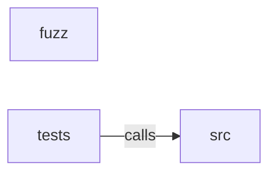

_Generated by CodeAtlas._

## Details

Owns 0 symbols across 1 file(s).

### fuzz

Owns 0 symbols across 2 file(s).

**Related Classes/Methods:** _None_

### src

Owns 833 symbols across 34 file(s).

**Related Classes/Methods:** _None_

**Source Files:**

- `crates/pyroboframes-core/src/adaptive.rs`
  - `crates.pyroboframes-core.src.adaptive.AdaptiveBatchSizer`
  - `crates.pyroboframes-core.src.adaptive.AdaptiveBatchSizer.adjust_batch_size`
  - `crates.pyroboframes-core.src.adaptive.AdaptiveBatchSizer.detect_constraint`
  - `crates.pyroboframes-core.src.adaptive.AdaptiveBatchSizer.estimate_required_memory`
  - `crates.pyroboframes-core.src.adaptive.AdaptiveBatchSizer.get_current_batch_size`
  - `crates.pyroboframes-core.src.adaptive.AdaptiveBatchSizer.get_history`
  - `crates.pyroboframes-core.src.adaptive.AdaptiveBatchSizer.increase_batch_size`
  - `crates.pyroboframes-core.src.adaptive.AdaptiveBatchSizer.new`
  - `crates.pyroboframes-core.src.adaptive.AdaptiveBatchSizer.optimize_for_cpu`
  - `crates.pyroboframes-core.src.adaptive.AdaptiveBatchSizer.optimize_for_gpu`
  - `crates.pyroboframes-core.src.adaptive.AdaptiveBatchSizer.reduce_batch_size`
  - `crates.pyroboframes-core.src.adaptive.BatchAdjustment`
  - `crates.pyroboframes-core.src.adaptive.BatchSizeRecommendation`
  - `crates.pyroboframes-core.src.adaptive.PerformanceMetrics`
  - `crates.pyroboframes-core.src.adaptive.ResourceConstraint`
  - `crates.pyroboframes-core.src.adaptive.ResourceConstraint.eq`
  - `crates.pyroboframes-core.src.adaptive.ResourceMetrics`
  - `crates.pyroboframes-core.src.adaptive.ResourceMonitor`
  - `crates.pyroboframes-core.src.adaptive.ResourceMonitor.default`
  - `crates.pyroboframes-core.src.adaptive.ResourceMonitor.get_peak_cpu_percent`
  - `crates.pyroboframes-core.src.adaptive.ResourceMonitor.get_peak_gpu_mb`
  - `crates.pyroboframes-core.src.adaptive.ResourceMonitor.get_peak_gpu_percent`
  - `crates.pyroboframes-core.src.adaptive.ResourceMonitor.get_peak_memory_mb`
  - `crates.pyroboframes-core.src.adaptive.ResourceMonitor.new`
  - `crates.pyroboframes-core.src.adaptive.ResourceMonitor.reset`
  - `crates.pyroboframes-core.src.adaptive.ResourceMonitor.update`
  - `crates.pyroboframes-core.src.adaptive.tests.test_adaptive_batch_sizer_creation`
  - `crates.pyroboframes-core.src.adaptive.tests.test_adjust_batch_size_with_constraints`
  - `crates.pyroboframes-core.src.adaptive.tests.test_batch_size_increase`
  - `crates.pyroboframes-core.src.adaptive.tests.test_batch_size_reduction`
  - `crates.pyroboframes-core.src.adaptive.tests.test_memory_estimation`
  - `crates.pyroboframes-core.src.adaptive.tests.test_no_constraint_increases_batch`
  - `crates.pyroboframes-core.src.adaptive.tests.test_resource_constraint_detection`
  - `crates.pyroboframes-core.src.adaptive.tests.test_resource_monitor`
- `crates/pyroboframes-core/src/anomaly.rs`
  - `crates.pyroboframes-core.src.anomaly.AnomalyDetector`
  - `crates.pyroboframes-core.src.anomaly.AnomalyDetector.clear_history`
  - `crates.pyroboframes-core.src.anomaly.AnomalyDetector.compute_color_imbalance`
  - `crates.pyroboframes-core.src.anomaly.AnomalyDetector.detect_anomalies`
  - `crates.pyroboframes-core.src.anomaly.AnomalyDetector.detect_missing_frames`
  - `crates.pyroboframes-core.src.anomaly.AnomalyDetector.get_all_anomalies`
  - `crates.pyroboframes-core.src.anomaly.AnomalyDetector.get_anomalies_by_type`
  - `crates.pyroboframes-core.src.anomaly.AnomalyDetector.get_anomaly_score`
  - `crates.pyroboframes-core.src.anomaly.AnomalyDetector.get_critical_anomalies`
  - `crates.pyroboframes-core.src.anomaly.AnomalyDetector.new`
  - `crates.pyroboframes-core.src.anomaly.AnomalyDetector.set_baseline_statistics`
  - `crates.pyroboframes-core.src.anomaly.AnomalyDetector.with_defaults`
  - `crates.pyroboframes-core.src.anomaly.AnomalyThresholds`
  - `crates.pyroboframes-core.src.anomaly.AnomalyThresholds.default`
  - `crates.pyroboframes-core.src.anomaly.AnomalyType`
  - `crates.pyroboframes-core.src.anomaly.ColorBalance`
  - `crates.pyroboframes-core.src.anomaly.FrameAnomalyScore`
  - `crates.pyroboframes-core.src.anomaly.FrameStatistics`
  - `crates.pyroboframes-core.src.anomaly.tests.create_stats`
  - `crates.pyroboframes-core.src.anomaly.tests.test_anomaly_detector_creation`
  - `crates.pyroboframes-core.src.anomaly.tests.test_blur_detection`
  - `crates.pyroboframes-core.src.anomaly.tests.test_clear_history`
  - `crates.pyroboframes-core.src.anomaly.tests.test_color_aberration_detection`
  - `crates.pyroboframes-core.src.anomaly.tests.test_get_anomalies_by_type`
  - `crates.pyroboframes-core.src.anomaly.tests.test_get_critical_anomalies`
  - `crates.pyroboframes-core.src.anomaly.tests.test_low_contrast_detection`
  - `crates.pyroboframes-core.src.anomaly.tests.test_low_entropy_detection`
  - `crates.pyroboframes-core.src.anomaly.tests.test_missing_frames_detection`
  - `crates.pyroboframes-core.src.anomaly.tests.test_statistical_outlier_detection`
  - `crates.pyroboframes-core.src.anomaly.tests.test_temporal_jitter_detection`
- `crates/pyroboframes-core/src/cache.rs`
  - `crates.pyroboframes-core.src.cache.CacheStats`
  - `crates.pyroboframes-core.src.cache.FrameCache`
  - `crates.pyroboframes-core.src.cache.L1Cache`
  - `crates.pyroboframes-core.src.cache.L1Cache.clear`
  - `crates.pyroboframes-core.src.cache.L1Cache.get`
  - `crates.pyroboframes-core.src.cache.L1Cache.new`
  - `crates.pyroboframes-core.src.cache.L1Cache.put`
  - `crates.pyroboframes-core.src.cache.L1Cache.stats`
  - `crates.pyroboframes-core.src.cache.L2Cache`
  - `crates.pyroboframes-core.src.cache.L2Cache.clear`
  - `crates.pyroboframes-core.src.cache.L2Cache.get`
  - `crates.pyroboframes-core.src.cache.L2Cache.new`
  - `crates.pyroboframes-core.src.cache.L2Cache.put`
  - `crates.pyroboframes-core.src.cache.Prefetcher`
  - `crates.pyroboframes-core.src.cache.Prefetcher.get_prefetch_range`
  - `crates.pyroboframes-core.src.cache.Prefetcher.new`
  - `crates.pyroboframes-core.src.cache.Prefetcher.should_prefetch`
  - `crates.pyroboframes-core.src.cache.tests.test_cache_stats_hit_rate`
  - `crates.pyroboframes-core.src.cache.tests.test_l1_cache_clear`
  - `crates.pyroboframes-core.src.cache.tests.test_l1_cache_eviction`
  - `crates.pyroboframes-core.src.cache.tests.test_l1_cache_hit`
  - `crates.pyroboframes-core.src.cache.tests.test_l1_cache_miss`
  - `crates.pyroboframes-core.src.cache.tests.test_l2_cache`
  - `crates.pyroboframes-core.src.cache.tests.test_prefetcher_range`
  - `crates.pyroboframes-core.src.cache.tests.test_prefetcher_should_prefetch`
- `crates/pyroboframes-core/src/calibration.rs`
  - `crates.pyroboframes-core.src.calibration.CameraCalibration`
  - `crates.pyroboframes-core.src.calibration.CameraCalibration.new`
  - `crates.pyroboframes-core.src.calibration.CameraCalibration.project_world_point`
  - `crates.pyroboframes-core.src.calibration.CameraCalibration.unproject_to_world_ray`
  - `crates.pyroboframes-core.src.calibration.CameraCalibration.with_all`
  - `crates.pyroboframes-core.src.calibration.CameraIntrinsics`
  - `crates.pyroboframes-core.src.calibration.CameraIntrinsics.k_matrix`
  - `crates.pyroboframes-core.src.calibration.CameraIntrinsics.new`
  - `crates.pyroboframes-core.src.calibration.CameraIntrinsics.project`
  - `crates.pyroboframes-core.src.calibration.CameraIntrinsics.unproject_direction`
  - `crates.pyroboframes-core.src.calibration.CameraPose`
  - `crates.pyroboframes-core.src.calibration.CameraPose.camera_to_world`
  - `crates.pyroboframes-core.src.calibration.CameraPose.extrinsic_matrix`
  - `crates.pyroboframes-core.src.calibration.CameraPose.identity`
  - `crates.pyroboframes-core.src.calibration.CameraPose.new`
  - `crates.pyroboframes-core.src.calibration.CameraPose.world_to_camera`
  - `crates.pyroboframes-core.src.calibration.DistortionModel`
  - `crates.pyroboframes-core.src.calibration.DistortionModel.apply`
  - `crates.pyroboframes-core.src.calibration.DistortionModel.default`
  - `crates.pyroboframes-core.src.calibration.DistortionModel.is_significant`
  - `crates.pyroboframes-core.src.calibration.DistortionModel.new`
  - `crates.pyroboframes-core.src.calibration.tests.distortion_is_significant`
  - `crates.pyroboframes-core.src.calibration.tests.distortion_no_distortion`
  - `crates.pyroboframes-core.src.calibration.tests.intrinsics_k_matrix`
  - `crates.pyroboframes-core.src.calibration.tests.intrinsics_project`
  - `crates.pyroboframes-core.src.calibration.tests.intrinsics_rejects_behind_camera`
  - `crates.pyroboframes-core.src.calibration.tests.pose_identity`
  - `crates.pyroboframes-core.src.calibration.tests.pose_roundtrip`
- `crates/pyroboframes-core/src/data.rs`
  - `crates.pyroboframes-core.src.data.DataShard`
  - `crates.pyroboframes-core.src.data.DataShard.feature_f32`
  - `crates.pyroboframes-core.src.data.DataShard.locate_row`
  - `crates.pyroboframes-core.src.data.DataShard.num_rows`
  - `crates.pyroboframes-core.src.data.DataShard.open`
  - `crates.pyroboframes-core.src.data.floats`
  - `crates.pyroboframes-core.src.data.tests.errors_on_bad_column_or_row`
  - `crates.pyroboframes-core.src.data.tests.reads_fixed_size_float_vectors`
  - `crates.pyroboframes-core.src.data.tests.reads_scalar_float_column_as_length_one_vector`
  - `crates.pyroboframes-core.src.data.tests.write_data_fixture`
- `crates/pyroboframes-core/src/dataset.rs`
  - `crates.pyroboframes-core.src.dataset.Dataset`
  - `crates.pyroboframes-core.src.dataset.Dataset.cameras`
  - `crates.pyroboframes-core.src.dataset.Dataset.data_file`
  - `crates.pyroboframes-core.src.dataset.Dataset.data_shard`
  - `crates.pyroboframes-core.src.dataset.Dataset.episodes`
  - `crates.pyroboframes-core.src.dataset.Dataset.fps`
  - `crates.pyroboframes-core.src.dataset.Dataset.frame_timestamp`
  - `crates.pyroboframes-core.src.dataset.Dataset.info`
  - `crates.pyroboframes-core.src.dataset.Dataset.num_episodes`
  - `crates.pyroboframes-core.src.dataset.Dataset.num_frames`
  - `crates.pyroboframes-core.src.dataset.Dataset.open`
  - `crates.pyroboframes-core.src.dataset.Dataset.root`
  - `crates.pyroboframes-core.src.dataset.Dataset.stats`
  - `crates.pyroboframes-core.src.dataset.Dataset.train_val_split`
  - `crates.pyroboframes-core.src.dataset.Dataset.validate`
  - `crates.pyroboframes-core.src.dataset.Dataset.video_file`
  - `crates.pyroboframes-core.src.dataset.tests.frame_timestamps_follow_fps`
  - `crates.pyroboframes-core.src.dataset.tests.opens_and_reads_schema`
  - `crates.pyroboframes-core.src.dataset.tests.rejects_non_dataset_dir`
  - `crates.pyroboframes-core.src.dataset.tests.resolves_absolute_shard_paths`
  - `crates.pyroboframes-core.src.dataset.tests.write_fixture`
- `crates/pyroboframes-core/src/decisions.rs`
  - `crates.pyroboframes-core.src.decisions.AutonomousDecision`
  - `crates.pyroboframes-core.src.decisions.DecisionEngine`
  - `crates.pyroboframes-core.src.decisions.DecisionEngine.default`
  - `crates.pyroboframes-core.src.decisions.DecisionEngine.execute_decision`
  - `crates.pyroboframes-core.src.decisions.DecisionEngine.get_critical_decisions`
  - `crates.pyroboframes-core.src.decisions.DecisionEngine.get_decision_by_id`
  - `crates.pyroboframes-core.src.decisions.DecisionEngine.get_execution_status`
  - `crates.pyroboframes-core.src.decisions.DecisionEngine.get_total_expected_improvement`
  - `crates.pyroboframes-core.src.decisions.DecisionEngine.make_batch_size_decision`
  - `crates.pyroboframes-core.src.decisions.DecisionEngine.make_cache_decision`
  - `crates.pyroboframes-core.src.decisions.DecisionEngine.make_prefetch_decision`
  - `crates.pyroboframes-core.src.decisions.DecisionEngine.make_quality_decision`
  - `crates.pyroboframes-core.src.decisions.DecisionEngine.new`
  - `crates.pyroboframes-core.src.decisions.DecisionEngine.rank_decisions_by_priority`
  - `crates.pyroboframes-core.src.decisions.DecisionPriority`
  - `crates.pyroboframes-core.src.decisions.DecisionPriority.severity_rank`
  - `crates.pyroboframes-core.src.decisions.RecommendationType`
  - `crates.pyroboframes-core.src.decisions.tests.test_batch_size_decision_critical`
  - `crates.pyroboframes-core.src.decisions.tests.test_batch_size_decision_low_priority`
  - `crates.pyroboframes-core.src.decisions.tests.test_cache_decision_aggressive`
  - `crates.pyroboframes-core.src.decisions.tests.test_cache_decision_flush`
  - `crates.pyroboframes-core.src.decisions.tests.test_decision_engine_creation`
  - `crates.pyroboframes-core.src.decisions.tests.test_execute_decision`
  - `crates.pyroboframes-core.src.decisions.tests.test_get_critical_decisions`
  - `crates.pyroboframes-core.src.decisions.tests.test_get_decision_by_id`
  - `crates.pyroboframes-core.src.decisions.tests.test_prefetch_decision_disable`
  - `crates.pyroboframes-core.src.decisions.tests.test_prefetch_decision_enable`
  - `crates.pyroboframes-core.src.decisions.tests.test_quality_decision_critical`
  - `crates.pyroboframes-core.src.decisions.tests.test_quality_decision_skip_anomalies`
  - `crates.pyroboframes-core.src.decisions.tests.test_rank_decisions_by_priority`
  - `crates.pyroboframes-core.src.decisions.tests.test_total_expected_improvement`
- `crates/pyroboframes-core/src/decode.rs`
  - `crates.pyroboframes-core.src.decode.Backend`
  - `crates.pyroboframes-core.src.decode.Backend.preferred`
  - `crates.pyroboframes-core.src.decode.Decoder`
  - `crates.pyroboframes-core.src.decode.Frame`
  - `crates.pyroboframes-core.src.decode.Frame.to_rgb24_bytes`
  - `crates.pyroboframes-core.src.decode.Frame.write_rgb24_into`
  - `crates.pyroboframes-core.src.decode.FrameBuffer`
  - `crates.pyroboframes-core.src.decode.FrameBuffer.as_bytes`
  - `crates.pyroboframes-core.src.decode.FrameBuffer.as_iosurface`
  - `crates.pyroboframes-core.src.decode.FrameBuffer.channels`
  - `crates.pyroboframes-core.src.decode.FrameBuffer.with_locked_bytes`
  - `crates.pyroboframes-core.src.decode.FrameCache`
  - `crates.pyroboframes-core.src.decode.FrameCache.get_or_decode`
  - `crates.pyroboframes-core.src.decode.FrameCache.is_empty`
  - `crates.pyroboframes-core.src.decode.FrameCache.len`
  - `crates.pyroboframes-core.src.decode.FrameCache.new`
  - `crates.pyroboframes-core.src.decode.FrameKey`
  - `crates.pyroboframes-core.src.decode.FrameKey.new`
  - `crates.pyroboframes-core.src.decode.FramePool`
  - `crates.pyroboframes-core.src.decode.FramePool.free_count`
  - `crates.pyroboframes-core.src.decode.FramePool.give`
  - `crates.pyroboframes-core.src.decode.FramePool.new`
  - `crates.pyroboframes-core.src.decode.FramePool.take`
  - `crates.pyroboframes-core.src.decode.cuda.CudaDecoder`
  - `crates.pyroboframes-core.src.decode.cuda.CudaDecoder.decode`
  - `crates.pyroboframes-core.src.decode.cuda.CudaDecoder.dimensions`
  - `crates.pyroboframes-core.src.decode.ffcli.ProbedFrame`
  - `crates.pyroboframes-core.src.decode.ffcli.decode_frame`
  - `crates.pyroboframes-core.src.decode.ffcli.decode_rgb24`
  - `crates.pyroboframes-core.src.decode.ffcli.decode_rgb24_sequential`
  - `crates.pyroboframes-core.src.decode.ffcli.frame`
  - `crates.pyroboframes-core.src.decode.ffcli.probe_codec`
  - `crates.pyroboframes-core.src.decode.ffcli.probe_dims`
  - `crates.pyroboframes-core.src.decode.ffcli.probe_frame_index`
  - `crates.pyroboframes-core.src.decode.linux.FfmpegDecoder`
  - `crates.pyroboframes-core.src.decode.linux.FfmpegDecoder.decode`
  - `crates.pyroboframes-core.src.decode.linux.FfmpegDecoder.decode_batch`
  - `crates.pyroboframes-core.src.decode.linux.FfmpegDecoder.dimensions`
  - `crates.pyroboframes-core.src.decode.linux.FfmpegDecoder.frame_index`
  - `crates.pyroboframes-core.src.decode.linux.FfmpegDecoder.keyframe_walkback`
  - `crates.pyroboframes-core.src.decode.linux.FfmpegDecoder.nearest_sample_index`
  - `crates.pyroboframes-core.src.decode.macos.VideoToolboxDecoder`
  - `crates.pyroboframes-core.src.decode.macos.VideoToolboxDecoder.av1_dims`
  - `crates.pyroboframes-core.src.decode.macos.VideoToolboxDecoder.decode`
  - `crates.pyroboframes-core.src.decode.macos.VideoToolboxDecoder.decode_batch`
  - `crates.pyroboframes-core.src.decode.macos.VideoToolboxDecoder.is_av1`
  - `crates.pyroboframes-core.src.decode.macos_ffmpeg_fallback.VideoToolboxDecoder`
  - `crates.pyroboframes-core.src.decode.macos_ffmpeg_fallback.VideoToolboxDecoder.decode`
  - `crates.pyroboframes-core.src.decode.macos_ffmpeg_fallback.VideoToolboxDecoder.decode_batch`
  - `crates.pyroboframes-core.src.decode.macos_ffmpeg_fallback.VideoToolboxDecoder.dimensions`
  - `crates.pyroboframes-core.src.decode.macos_ffmpeg_fallback.VideoToolboxDecoder.frame_index`
  - `crates.pyroboframes-core.src.decode.macos_ffmpeg_fallback.VideoToolboxDecoder.keyframe_walkback`
  - `crates.pyroboframes-core.src.decode.macos_ffmpeg_fallback.VideoToolboxDecoder.nearest_sample_index`
  - `crates.pyroboframes-core.src.decode.tests.MockDecoder`
  - `crates.pyroboframes-core.src.decode.tests.MockDecoder.decode`
  - `crates.pyroboframes-core.src.decode.tests.MockDecoder.new`
  - `crates.pyroboframes-core.src.decode.tests.av1_file_decodes_via_real_ffmpeg_fallback_and_matches_reference`
  - `crates.pyroboframes-core.src.decode.tests.cache_avoids_redecoding_same_frame`
  - `crates.pyroboframes-core.src.decode.tests.cache_evicts_least_recently_used`
  - `crates.pyroboframes-core.src.decode.tests.decode_batch_defaults_to_per_frame`
  - `crates.pyroboframes-core.src.decode.tests.decode_batch_matches_per_frame_decode_and_reduces_ffmpeg_invocations`
  - `crates.pyroboframes-core.src.decode.tests.ffmpeg_decoder_decodes_a_real_frame`
  - `crates.pyroboframes-core.src.decode.tests.generate_gop_test_clip`
  - `crates.pyroboframes-core.src.decode.tests.macos_fallback_decode_batch_matches_per_frame_decode_and_reduces_ffmpeg_invocations`
  - `crates.pyroboframes-core.src.decode.tests.pool_reuses_buffers`
  - `crates.pyroboframes-core.src.decode.tests.preferred_backend_matches_platform`
  - `crates.pyroboframes-core.src.decode.tests.write_rgb24_into_matches_to_rgb24_bytes`
  - `crates.pyroboframes-core.src.decode.tests.write_rgb24_into_writes_only_its_own_slice_of_a_larger_buffer`
- `crates/pyroboframes-core/src/depth.rs`
  - `crates.pyroboframes-core.src.depth.PointCloud`
  - `crates.pyroboframes-core.src.depth.PointCloud.is_empty`
  - `crates.pyroboframes-core.src.depth.PointCloud.len`
  - `crates.pyroboframes-core.src.depth.PointCloud.load`
  - `crates.pyroboframes-core.src.depth.PointCloud.load_npy`
  - `crates.pyroboframes-core.src.depth.PointCloud.load_pcd`
  - `crates.pyroboframes-core.src.depth.PointCloud.load_ply`
  - `crates.pyroboframes-core.src.depth.PointCloud.load_xyz`
  - `crates.pyroboframes-core.src.depth.PointCloud.new`
  - `crates.pyroboframes-core.src.depth.tests.loads_pcd_format`
  - `crates.pyroboframes-core.src.depth.tests.loads_ply_format`
  - `crates.pyroboframes-core.src.depth.tests.loads_xyz_format`
  - `crates.pyroboframes-core.src.depth.tests.loads_xyz_with_comments`
  - `crates.pyroboframes-core.src.depth.tests.rejects_unsupported_format`
  - `crates.pyroboframes-core.src.depth.tests.write_temp_file`
  - `crates.pyroboframes-core.src.depth.tests.xyz_rejects_missing_coordinates`
- `crates/pyroboframes-core/src/distributed.rs`
  - `crates.pyroboframes-core.src.distributed.DistributedCoordinator`
  - `crates.pyroboframes-core.src.distributed.DistributedCoordinator.aggregate_distributed_votes`
  - `crates.pyroboframes-core.src.distributed.DistributedCoordinator.can_reach_quorum`
  - `crates.pyroboframes-core.src.distributed.DistributedCoordinator.elect_leader`
  - `crates.pyroboframes-core.src.distributed.DistributedCoordinator.get_active_nodes`
  - `crates.pyroboframes-core.src.distributed.DistributedCoordinator.get_arbitration_cases`
  - `crates.pyroboframes-core.src.distributed.DistributedCoordinator.get_consensus_history`
  - `crates.pyroboframes-core.src.distributed.DistributedCoordinator.get_network_health`
  - `crates.pyroboframes-core.src.distributed.DistributedCoordinator.get_node_by_region`
  - `crates.pyroboframes-core.src.distributed.DistributedCoordinator.get_node_metrics`
  - `crates.pyroboframes-core.src.distributed.DistributedCoordinator.mark_node_offline`
  - `crates.pyroboframes-core.src.distributed.DistributedCoordinator.mark_node_online`
  - `crates.pyroboframes-core.src.distributed.DistributedCoordinator.new`
  - `crates.pyroboframes-core.src.distributed.DistributedCoordinator.node_count`
  - `crates.pyroboframes-core.src.distributed.DistributedCoordinator.quorum_size`
  - `crates.pyroboframes-core.src.distributed.DistributedCoordinator.register_node`
  - `crates.pyroboframes-core.src.distributed.DistributedCoordinator.update_node_metrics`
  - `crates.pyroboframes-core.src.distributed.DistributedVote`
  - `crates.pyroboframes-core.src.distributed.NetworkHealth`
  - `crates.pyroboframes-core.src.distributed.Node`
  - `crates.pyroboframes-core.src.distributed.NodeMetrics`
  - `crates.pyroboframes-core.src.distributed.tests.test_arbitration_case_detection`
  - `crates.pyroboframes-core.src.distributed.tests.test_coordinator_creation`
  - `crates.pyroboframes-core.src.distributed.tests.test_distributed_voting`
  - `crates.pyroboframes-core.src.distributed.tests.test_get_active_nodes`
  - `crates.pyroboframes-core.src.distributed.tests.test_get_node_by_region`
  - `crates.pyroboframes-core.src.distributed.tests.test_high_disagreement_detection`
  - `crates.pyroboframes-core.src.distributed.tests.test_leader_election`
  - `crates.pyroboframes-core.src.distributed.tests.test_network_health`
  - `crates.pyroboframes-core.src.distributed.tests.test_node_metrics_tracking`
  - `crates.pyroboframes-core.src.distributed.tests.test_node_offline_detection`
  - `crates.pyroboframes-core.src.distributed.tests.test_quorum_check`
  - `crates.pyroboframes-core.src.distributed.tests.test_register_node`
- `crates/pyroboframes-core/src/ensemble.rs`
  - `crates.pyroboframes-core.src.ensemble.EnsembleOrchestrator`
  - `crates.pyroboframes-core.src.ensemble.EnsembleOrchestrator.aggregate_predictions`
  - `crates.pyroboframes-core.src.ensemble.EnsembleOrchestrator.bayesian_ensemble`
  - `crates.pyroboframes-core.src.ensemble.EnsembleOrchestrator.calculate_std_dev`
  - `crates.pyroboframes-core.src.ensemble.EnsembleOrchestrator.clear_predictions`
  - `crates.pyroboframes-core.src.ensemble.EnsembleOrchestrator.confidence_weighted`
  - `crates.pyroboframes-core.src.ensemble.EnsembleOrchestrator.enable_model`
  - `crates.pyroboframes-core.src.ensemble.EnsembleOrchestrator.get_best_model`
  - `crates.pyroboframes-core.src.ensemble.EnsembleOrchestrator.get_ensemble_stats`
  - `crates.pyroboframes-core.src.ensemble.EnsembleOrchestrator.get_model`
  - `crates.pyroboframes-core.src.ensemble.EnsembleOrchestrator.get_model_performance`
  - `crates.pyroboframes-core.src.ensemble.EnsembleOrchestrator.new`
  - `crates.pyroboframes-core.src.ensemble.EnsembleOrchestrator.predictions_count`
  - `crates.pyroboframes-core.src.ensemble.EnsembleOrchestrator.record_performance`
  - `crates.pyroboframes-core.src.ensemble.EnsembleOrchestrator.register_model`
  - `crates.pyroboframes-core.src.ensemble.EnsembleOrchestrator.set_model_weight`
  - `crates.pyroboframes-core.src.ensemble.EnsembleOrchestrator.submit_prediction`
  - `crates.pyroboframes-core.src.ensemble.EnsembleOrchestrator.unweighted_majority`
  - `crates.pyroboframes-core.src.ensemble.EnsembleOrchestrator.weighted_majority`
  - `crates.pyroboframes-core.src.ensemble.EnsembleStats`
  - `crates.pyroboframes-core.src.ensemble.EnsembleVote`
  - `crates.pyroboframes-core.src.ensemble.ModelMetadata`
  - `crates.pyroboframes-core.src.ensemble.ModelPerformanceRecord`
  - `crates.pyroboframes-core.src.ensemble.ModelPrediction`
  - `crates.pyroboframes-core.src.ensemble.PredictionType`
  - `crates.pyroboframes-core.src.ensemble.VotingStrategy`
  - `crates.pyroboframes-core.src.ensemble.tests.test_bayesian_ensemble`
  - `crates.pyroboframes-core.src.ensemble.tests.test_confidence_weighted_voting`
  - `crates.pyroboframes-core.src.ensemble.tests.test_ensemble_stats`
  - `crates.pyroboframes-core.src.ensemble.tests.test_get_best_model`
  - `crates.pyroboframes-core.src.ensemble.tests.test_model_enable_disable`
  - `crates.pyroboframes-core.src.ensemble.tests.test_model_performance_tracking`
  - `crates.pyroboframes-core.src.ensemble.tests.test_orchestrator_creation`
  - `crates.pyroboframes-core.src.ensemble.tests.test_register_model`
  - `crates.pyroboframes-core.src.ensemble.tests.test_set_model_weight`
  - `crates.pyroboframes-core.src.ensemble.tests.test_submit_prediction`
  - `crates.pyroboframes-core.src.ensemble.tests.test_unweighted_majority_voting`
  - `crates.pyroboframes-core.src.ensemble.tests.test_weighted_majority_voting`
- `crates/pyroboframes-core/src/episodes.rs`
  - `crates.pyroboframes-core.src.episodes.EpisodeIndex`
  - `crates.pyroboframes-core.src.episodes.EpisodeIndex.episodes`
  - `crates.pyroboframes-core.src.episodes.EpisodeIndex.is_empty`
  - `crates.pyroboframes-core.src.episodes.EpisodeIndex.len`
  - `crates.pyroboframes-core.src.episodes.EpisodeIndex.load`
  - `crates.pyroboframes-core.src.episodes.EpisodeIndex.locate`
  - `crates.pyroboframes-core.src.episodes.EpisodeIndex.total_frames`
  - `crates.pyroboframes-core.src.episodes.EpisodeRecord`
  - `crates.pyroboframes-core.src.episodes.FrameLocation`
  - `crates.pyroboframes-core.src.episodes.VideoLocation`
  - `crates.pyroboframes-core.src.episodes.collect_parquet`
  - `crates.pyroboframes-core.src.episodes.f64_col`
  - `crates.pyroboframes-core.src.episodes.int_col`
  - `crates.pyroboframes-core.src.episodes.read_batches`
  - `crates.pyroboframes-core.src.episodes.read_episode_file`
  - `crates.pyroboframes-core.src.episodes.tests.loads_and_locates_frames`
  - `crates.pyroboframes-core.src.episodes.tests.out_of_range_returns_none`
  - `crates.pyroboframes-core.src.episodes.tests.write_fixture`
- `crates/pyroboframes-core/src/feedback.rs`
  - `crates.pyroboframes-core.src.feedback.ConfidenceAnalysis`
  - `crates.pyroboframes-core.src.feedback.DecisionOutcome`
  - `crates.pyroboframes-core.src.feedback.FeedbackLoop`
  - `crates.pyroboframes-core.src.feedback.FeedbackLoop.add_retraining_trigger`
  - `crates.pyroboframes-core.src.feedback.FeedbackLoop.analyze_prediction_confidence`
  - `crates.pyroboframes-core.src.feedback.FeedbackLoop.clear_old_data`
  - `crates.pyroboframes-core.src.feedback.FeedbackLoop.decision_outcomes_count`
  - `crates.pyroboframes-core.src.feedback.FeedbackLoop.detect_performance_trends`
  - `crates.pyroboframes-core.src.feedback.FeedbackLoop.get_critical_triggers`
  - `crates.pyroboframes-core.src.feedback.FeedbackLoop.get_decision_success_rate`
  - `crates.pyroboframes-core.src.feedback.FeedbackLoop.get_learning_report`
  - `crates.pyroboframes-core.src.feedback.FeedbackLoop.get_metric`
  - `crates.pyroboframes-core.src.feedback.FeedbackLoop.get_recent_decisions`
  - `crates.pyroboframes-core.src.feedback.FeedbackLoop.max_history`
  - `crates.pyroboframes-core.src.feedback.FeedbackLoop.new`
  - `crates.pyroboframes-core.src.feedback.FeedbackLoop.prediction_feedback`
  - `crates.pyroboframes-core.src.feedback.FeedbackLoop.prediction_feedback_count`
  - `crates.pyroboframes-core.src.feedback.FeedbackLoop.record_decision_outcome`
  - `crates.pyroboframes-core.src.feedback.FeedbackLoop.record_prediction_feedback`
  - `crates.pyroboframes-core.src.feedback.FeedbackLoop.retraining_triggers`
  - `crates.pyroboframes-core.src.feedback.FeedbackLoop.trigger_retraining_if_needed`
  - `crates.pyroboframes-core.src.feedback.FeedbackLoop.update_metric`
  - `crates.pyroboframes-core.src.feedback.LearningReport`
  - `crates.pyroboframes-core.src.feedback.PerformanceMetric`
  - `crates.pyroboframes-core.src.feedback.PerformanceTrend`
  - `crates.pyroboframes-core.src.feedback.PredictionFeedback`
  - `crates.pyroboframes-core.src.feedback.RetrainingTrigger`
  - `crates.pyroboframes-core.src.feedback.TrendDirection`
  - `crates.pyroboframes-core.src.feedback.TriggerPriority`
  - `crates.pyroboframes-core.src.feedback.TriggerPriority.severity_rank`
  - `crates.pyroboframes-core.src.feedback.tests.test_confidence_analysis`
  - `crates.pyroboframes-core.src.feedback.tests.test_critical_triggers`
  - `crates.pyroboframes-core.src.feedback.tests.test_decision_success_rate`
  - `crates.pyroboframes-core.src.feedback.tests.test_degrading_trend_detection`
  - `crates.pyroboframes-core.src.feedback.tests.test_feedback_loop_creation`
  - `crates.pyroboframes-core.src.feedback.tests.test_learning_report`
  - `crates.pyroboframes-core.src.feedback.tests.test_max_history_enforcement`
  - `crates.pyroboframes-core.src.feedback.tests.test_performance_trend_detection`
  - `crates.pyroboframes-core.src.feedback.tests.test_recent_decisions`
  - `crates.pyroboframes-core.src.feedback.tests.test_record_decision_outcome`
  - `crates.pyroboframes-core.src.feedback.tests.test_record_prediction_feedback`
  - `crates.pyroboframes-core.src.feedback.tests.test_retraining_trigger`
- `crates/pyroboframes-core/src/info.rs`
  - `crates.pyroboframes-core.src.info.Feature`
  - `crates.pyroboframes-core.src.info.Feature.is_video`
  - `crates.pyroboframes-core.src.info.Info`
  - `crates.pyroboframes-core.src.info.Info.camera_keys`
  - `crates.pyroboframes-core.src.info.Info.data_file_path`
  - `crates.pyroboframes-core.src.info.Info.get_video_codec`
  - `crates.pyroboframes-core.src.info.Info.load`
  - `crates.pyroboframes-core.src.info.Info.video_file_path`
  - `crates.pyroboframes-core.src.info.default_chunks_size`
  - `crates.pyroboframes-core.src.info.default_video_codec`
  - `crates.pyroboframes-core.src.info.parse_zero_pad_width`
  - `crates.pyroboframes-core.src.info.render_path`
  - `crates.pyroboframes-core.src.info.replace_indexed`
  - `crates.pyroboframes-core.src.info.tests.identifies_camera_features`
  - `crates.pyroboframes-core.src.info.tests.renders_zero_padded_paths`
  - `crates.pyroboframes-core.src.info.tests.sample_info`
- `crates/pyroboframes-core/src/intelligence.rs`
  - `crates.pyroboframes-core.src.intelligence.AccessPattern`
  - `crates.pyroboframes-core.src.intelligence.CachePrediction`
  - `crates.pyroboframes-core.src.intelligence.CachePriority`
  - `crates.pyroboframes-core.src.intelligence.CachePriority.severity_rank`
  - `crates.pyroboframes-core.src.intelligence.DatasetScore`
  - `crates.pyroboframes-core.src.intelligence.DatasetSelector`
  - `crates.pyroboframes-core.src.intelligence.DatasetSelector.default`
  - `crates.pyroboframes-core.src.intelligence.DatasetSelector.get_quality_score`
  - `crates.pyroboframes-core.src.intelligence.DatasetSelector.is_sequential_access`
  - `crates.pyroboframes-core.src.intelligence.DatasetSelector.new`
  - `crates.pyroboframes-core.src.intelligence.DatasetSelector.rank_datasets`
  - `crates.pyroboframes-core.src.intelligence.DatasetSelector.record_access_pattern`
  - `crates.pyroboframes-core.src.intelligence.DatasetSelector.register_dataset`
  - `crates.pyroboframes-core.src.intelligence.DatasetSelector.register_quality_metrics`
  - `crates.pyroboframes-core.src.intelligence.DatasetSelector.select_best_dataset`
  - `crates.pyroboframes-core.src.intelligence.PredictiveCache`
  - `crates.pyroboframes-core.src.intelligence.PredictiveCache.get_critical_frames`
  - `crates.pyroboframes-core.src.intelligence.PredictiveCache.get_prediction`
  - `crates.pyroboframes-core.src.intelligence.PredictiveCache.new`
  - `crates.pyroboframes-core.src.intelligence.PredictiveCache.record_access`
  - `crates.pyroboframes-core.src.intelligence.PredictiveCache.should_prefetch`
  - `crates.pyroboframes-core.src.intelligence.PredictiveCache.update_predictions`
  - `crates.pyroboframes-core.src.intelligence.QualityMetrics`
  - `crates.pyroboframes-core.src.intelligence.tests.test_dataset_selector_creation`
  - `crates.pyroboframes-core.src.intelligence.tests.test_get_critical_frames`
  - `crates.pyroboframes-core.src.intelligence.tests.test_predictive_cache_creation`
  - `crates.pyroboframes-core.src.intelligence.tests.test_quality_metrics`
  - `crates.pyroboframes-core.src.intelligence.tests.test_rank_datasets`
  - `crates.pyroboframes-core.src.intelligence.tests.test_record_access`
  - `crates.pyroboframes-core.src.intelligence.tests.test_register_dataset`
  - `crates.pyroboframes-core.src.intelligence.tests.test_select_best_dataset`
  - `crates.pyroboframes-core.src.intelligence.tests.test_sequential_access_detection`
  - `crates.pyroboframes-core.src.intelligence.tests.test_should_prefetch`
- `crates/pyroboframes-core/src/lib.rs`
  - `crates.pyroboframes-core.src.lib.Error`
  - `crates.pyroboframes-core.src.lib.LoaderConfig`
  - `crates.pyroboframes-core.src.lib.LoaderConfig.default`
  - `crates.pyroboframes-core.src.lib.ValidationReport`
  - `crates.pyroboframes-core.src.lib.ValidationReport.is_ok`
  - `crates.pyroboframes-core.src.lib.ValidationReport.raise_if_errors`
  - `crates.pyroboframes-core.src.lib.tests.loader_config_defaults_are_sane`
  - `crates.pyroboframes-core.src.lib.tests.report_distinguishes_errors_from_warnings`
- `crates/pyroboframes-core/src/loader.rs`
  - `crates.pyroboframes-core.src.loader.Sample`
  - `crates.pyroboframes-core.src.loader.TabularLoader`
  - `crates.pyroboframes-core.src.loader.TabularLoader.apply_norm`
  - `crates.pyroboframes-core.src.loader.TabularLoader.batch`
  - `crates.pyroboframes-core.src.loader.TabularLoader.curriculum_key`
  - `crates.pyroboframes-core.src.loader.TabularLoader.dataset`
  - `crates.pyroboframes-core.src.loader.TabularLoader.enable_normalization`
  - `crates.pyroboframes-core.src.loader.TabularLoader.ensure_open`
  - `crates.pyroboframes-core.src.loader.TabularLoader.episode_runs`
  - `crates.pyroboframes-core.src.loader.TabularLoader.features`
  - `crates.pyroboframes-core.src.loader.TabularLoader.frame_indices_for_episodes`
  - `crates.pyroboframes-core.src.loader.TabularLoader.frames_for`
  - `crates.pyroboframes-core.src.loader.TabularLoader.goal_index`
  - `crates.pyroboframes-core.src.loader.TabularLoader.locate`
  - `crates.pyroboframes-core.src.loader.TabularLoader.open`
  - `crates.pyroboframes-core.src.loader.TabularLoader.sample`
  - `crates.pyroboframes-core.src.loader.TabularLoader.total_frames`
  - `crates.pyroboframes-core.src.loader.TabularLoader.windowed_frames_for`
  - `crates.pyroboframes-core.src.loader.TabularLoader.windowed_sample`
  - `crates.pyroboframes-core.src.loader.TabularLoader.with_features`
  - `crates.pyroboframes-core.src.loader.WindowedSample`
  - `crates.pyroboframes-core.src.loader.decode_frames`
  - `crates.pyroboframes-core.src.loader.tests.MockDecoder`
  - `crates.pyroboframes-core.src.loader.tests.MockDecoder.decode`
  - `crates.pyroboframes-core.src.loader.tests.batches_multiple_frames`
  - `crates.pyroboframes-core.src.loader.tests.builds_samples_end_to_end`
  - `crates.pyroboframes-core.src.loader.tests.decode_frames_resolves_each_camera`
  - `crates.pyroboframes-core.src.loader.tests.episode_runs_partition_the_population`
  - `crates.pyroboframes-core.src.loader.tests.frame_indices_for_episodes_selects_subset`
  - `crates.pyroboframes-core.src.loader.tests.normalization_applies_mean_std`
  - `crates.pyroboframes-core.src.loader.tests.normalization_requires_stats`
  - `crates.pyroboframes-core.src.loader.tests.window_spec`
  - `crates.pyroboframes-core.src.loader.tests.windowed_sample_clamps_at_episode_boundary`
  - `crates.pyroboframes-core.src.loader.tests.windowed_sample_gathers_temporal_context`
  - `crates.pyroboframes-core.src.loader.tests.write_data`
  - `crates.pyroboframes-core.src.loader.tests.write_dataset`
  - `crates.pyroboframes-core.src.loader.tests.write_episodes`
- `crates/pyroboframes-core/src/mcap.rs`
  - `crates.pyroboframes-core.src.mcap.ColInfo`
  - `crates.pyroboframes-core.src.mcap.ColKind`
  - `crates.pyroboframes-core.src.mcap.ColStats`
  - `crates.pyroboframes-core.src.mcap.ConversionReport`
  - `crates.pyroboframes-core.src.mcap.Leaf`
  - `crates.pyroboframes-core.src.mcap.TopicAccum`
  - `crates.pyroboframes-core.src.mcap.TopicConversion`
  - `crates.pyroboframes-core.src.mcap.TopicDecoder`
  - `crates.pyroboframes-core.src.mcap.TopicDecoder.build`
  - `crates.pyroboframes-core.src.mcap.TopicDecoder.build_protobuf`
  - `crates.pyroboframes-core.src.mcap.TopicDecoder.build_ros2`
  - `crates.pyroboframes-core.src.mcap.TopicDecoder.decode`
  - `crates.pyroboframes-core.src.mcap.column_stats`
  - `crates.pyroboframes-core.src.mcap.convert`
  - `crates.pyroboframes-core.src.mcap.flatten`
  - `crates.pyroboframes-core.src.mcap.infer_kind`
  - `crates.pyroboframes-core.src.mcap.leaf_to_string`
  - `crates.pyroboframes-core.src.mcap.read_messages`
  - `crates.pyroboframes-core.src.mcap.sanitize`
  - `crates.pyroboframes-core.src.mcap.tests.converts_cdr_ros2msg_topics`
  - `crates.pyroboframes-core.src.mcap.tests.converts_json_topics_and_skips_others`
  - `crates.pyroboframes-core.src.mcap.tests.converts_protobuf_topics_via_embedded_descriptor`
  - `crates.pyroboframes-core.src.mcap.tests.missing_fields_become_nulls`
  - `crates.pyroboframes-core.src.mcap.tests.proto_descriptor_set`
  - `crates.pyroboframes-core.src.mcap.tests.write_mcap`
  - `crates.pyroboframes-core.src.mcap.tests.writes_dataset_metadata_and_stats`
  - `crates.pyroboframes-core.src.mcap.write_all`
  - `crates.pyroboframes-core.src.mcap.write_json`
  - `crates.pyroboframes-core.src.mcap.write_topic`
- `crates/pyroboframes-core/src/mcp.rs`
  - `crates.pyroboframes-core.src.mcp.DatasetInfo`
  - `crates.pyroboframes-core.src.mcp.EpisodeMetadata`
  - `crates.pyroboframes-core.src.mcp.LoaderStatus`
  - `crates.pyroboframes-core.src.mcp.MCPTools`
  - `crates.pyroboframes-core.src.mcp.MCPTools.check_data_consistency`
  - `crates.pyroboframes-core.src.mcp.MCPTools.compare_datasets`
  - `crates.pyroboframes-core.src.mcp.MCPTools.get_dataset_info`
  - `crates.pyroboframes-core.src.mcp.MCPTools.get_dataset_stats`
  - `crates.pyroboframes-core.src.mcp.MCPTools.get_episode_metadata`
  - `crates.pyroboframes-core.src.mcp.MCPTools.get_loader_status`
  - `crates.pyroboframes-core.src.mcp.MCPTools.list_episodes`
  - `crates.pyroboframes-core.src.mcp.MCPTools.list_supported_formats`
  - `crates.pyroboframes-core.src.mcp.MCPTools.validate_dataset`
  - `crates.pyroboframes-core.src.mcp.ValidationResult`
  - `crates.pyroboframes-core.src.mcp.tests.test_check_data_consistency`
  - `crates.pyroboframes-core.src.mcp.tests.test_compare_datasets`
  - `crates.pyroboframes-core.src.mcp.tests.test_get_dataset_info`
  - `crates.pyroboframes-core.src.mcp.tests.test_get_dataset_stats`
  - `crates.pyroboframes-core.src.mcp.tests.test_get_episode_metadata`
  - `crates.pyroboframes-core.src.mcp.tests.test_get_loader_status`
  - `crates.pyroboframes-core.src.mcp.tests.test_list_episodes`
  - `crates.pyroboframes-core.src.mcp.tests.test_list_supported_formats`
  - `crates.pyroboframes-core.src.mcp.tests.test_validate_dataset`
- `crates/pyroboframes-core/src/metrics.rs`
  - `crates.pyroboframes-core.src.metrics.Histogram`
  - `crates.pyroboframes-core.src.metrics.HistogramBucket`
  - `crates.pyroboframes-core.src.metrics.LatencyMetrics`
  - `crates.pyroboframes-core.src.metrics.MetricsCollector`
  - `crates.pyroboframes-core.src.metrics.MetricsCollector.calculate_percentiles`
  - `crates.pyroboframes-core.src.metrics.MetricsCollector.default`
  - `crates.pyroboframes-core.src.metrics.MetricsCollector.get_all_metrics`
  - `crates.pyroboframes-core.src.metrics.MetricsCollector.get_operation_metrics`
  - `crates.pyroboframes-core.src.metrics.MetricsCollector.get_system_metrics`
  - `crates.pyroboframes-core.src.metrics.MetricsCollector.new`
  - `crates.pyroboframes-core.src.metrics.MetricsCollector.record_operation`
  - `crates.pyroboframes-core.src.metrics.MetricsCollector.reset`
  - `crates.pyroboframes-core.src.metrics.MetricsCollector.update_system_metrics`
  - `crates.pyroboframes-core.src.metrics.OperationMetrics`
  - `crates.pyroboframes-core.src.metrics.SystemMetrics`
  - `crates.pyroboframes-core.src.metrics.Timer`
  - `crates.pyroboframes-core.src.metrics.Timer.elapsed`
  - `crates.pyroboframes-core.src.metrics.Timer.elapsed_ms`
  - `crates.pyroboframes-core.src.metrics.Timer.start`
  - `crates.pyroboframes-core.src.metrics.tests.test_latency_calculation`
  - `crates.pyroboframes-core.src.metrics.tests.test_metrics_collector_creation`
  - `crates.pyroboframes-core.src.metrics.tests.test_metrics_reset`
  - `crates.pyroboframes-core.src.metrics.tests.test_percentile_accuracy`
  - `crates.pyroboframes-core.src.metrics.tests.test_record_operation_failure`
  - `crates.pyroboframes-core.src.metrics.tests.test_record_operation_success`
  - `crates.pyroboframes-core.src.metrics.tests.test_system_metrics_update`
  - `crates.pyroboframes-core.src.metrics.tests.test_throughput_calculation`
  - `crates.pyroboframes-core.src.metrics.tests.test_timer`
- `crates/pyroboframes-core/src/models.rs`
  - `crates.pyroboframes-core.src.models.ModelCoefficients`
  - `crates.pyroboframes-core.src.models.ModelCoefficients.default`
  - `crates.pyroboframes-core.src.models.ModelCoefficients.default_latency`
  - `crates.pyroboframes-core.src.models.ModelEvaluation`
  - `crates.pyroboframes-core.src.models.PerformanceModel`
  - `crates.pyroboframes-core.src.models.PerformanceModel.add_training_sample`
  - `crates.pyroboframes-core.src.models.PerformanceModel.evaluate`
  - `crates.pyroboframes-core.src.models.PerformanceModel.get_model_id`
  - `crates.pyroboframes-core.src.models.PerformanceModel.get_training_samples_count`
  - `crates.pyroboframes-core.src.models.PerformanceModel.new`
  - `crates.pyroboframes-core.src.models.PerformanceModel.predict`
  - `crates.pyroboframes-core.src.models.PerformanceModel.predict_latency`
  - `crates.pyroboframes-core.src.models.PerformanceModel.predict_latency_components`
  - `crates.pyroboframes-core.src.models.PerformanceModel.predict_throughput`
  - `crates.pyroboframes-core.src.models.PerformanceModel.predict_throughput_components`
  - `crates.pyroboframes-core.src.models.PerformanceModel.retrain`
  - `crates.pyroboframes-core.src.models.PerformancePrediction`
  - `crates.pyroboframes-core.src.models.TrainingDatapoint`
  - `crates.pyroboframes-core.src.models.tests.test_add_training_sample`
  - `crates.pyroboframes-core.src.models.tests.test_batch_size_impact_on_throughput`
  - `crates.pyroboframes-core.src.models.tests.test_latency_prediction`
  - `crates.pyroboframes-core.src.models.tests.test_model_evaluation`
  - `crates.pyroboframes-core.src.models.tests.test_performance_model_creation`
  - `crates.pyroboframes-core.src.models.tests.test_prediction_confidence`
  - `crates.pyroboframes-core.src.models.tests.test_prediction_consistency`
  - `crates.pyroboframes-core.src.models.tests.test_resource_pressure_impact_on_latency`
  - `crates.pyroboframes-core.src.models.tests.test_throughput_prediction`
  - `crates.pyroboframes-core.src.models.tests.test_training_data_bounded`
- `crates/pyroboframes-core/src/pipeline.rs`
  - `crates.pyroboframes-core.src.pipeline.AssemblerConfig`
  - `crates.pyroboframes-core.src.pipeline.BatchAssembler`
  - `crates.pyroboframes-core.src.pipeline.BatchAssembler.assemble`
  - `crates.pyroboframes-core.src.pipeline.BatchAssembler.build`
  - `crates.pyroboframes-core.src.pipeline.Prefetcher`
  - `crates.pyroboframes-core.src.pipeline.Prefetcher.next_batch`
  - `crates.pyroboframes-core.src.pipeline.Prefetcher.num_batches`
  - `crates.pyroboframes-core.src.pipeline.Prefetcher.start`
  - `crates.pyroboframes-core.src.pipeline.RustBatch`
  - `crates.pyroboframes-core.src.pipeline.make_jobs`
- `crates/pyroboframes-core/src/quality.rs`
  - `crates.pyroboframes-core.src.quality.DatasetQualityReport`
  - `crates.pyroboframes-core.src.quality.EffortLevel`
  - `crates.pyroboframes-core.src.quality.QualityAssessor`
  - `crates.pyroboframes-core.src.quality.QualityAssessor.assess_dataset_quality`
  - `crates.pyroboframes-core.src.quality.QualityAssessor.create_quality_report`
  - `crates.pyroboframes-core.src.quality.QualityAssessor.default`
  - `crates.pyroboframes-core.src.quality.QualityAssessor.generate_recommendations`
  - `crates.pyroboframes-core.src.quality.QualityAssessor.get_quality_trend`
  - `crates.pyroboframes-core.src.quality.QualityAssessor.new`
  - `crates.pyroboframes-core.src.quality.QualityAssessor.should_trigger_reprocessing`
  - `crates.pyroboframes-core.src.quality.QualityRecommendation`
  - `crates.pyroboframes-core.src.quality.QualityScore`
  - `crates.pyroboframes-core.src.quality.QualitySeverity`
  - `crates.pyroboframes-core.src.quality.RecommendationCategory`
  - `crates.pyroboframes-core.src.quality.tests.test_anomalous_data_recommendation`
  - `crates.pyroboframes-core.src.quality.tests.test_missing_data_recommendation`
  - `crates.pyroboframes-core.src.quality.tests.test_performance_optimization_recommendation`
  - `crates.pyroboframes-core.src.quality.tests.test_quality_assessment`
  - `crates.pyroboframes-core.src.quality.tests.test_quality_report_creation`
  - `crates.pyroboframes-core.src.quality.tests.test_quality_score_creation`
  - `crates.pyroboframes-core.src.quality.tests.test_quality_trend`
  - `crates.pyroboframes-core.src.quality.tests.test_reprocessing_trigger_low_quality`
- `crates/pyroboframes-core/src/resilience.rs`
  - `crates.pyroboframes-core.src.resilience.BulkheadPattern`
  - `crates.pyroboframes-core.src.resilience.BulkheadPattern.acquire`
  - `crates.pyroboframes-core.src.resilience.BulkheadPattern.can_acquire`
  - `crates.pyroboframes-core.src.resilience.BulkheadPattern.get_utilization`
  - `crates.pyroboframes-core.src.resilience.BulkheadPattern.new`
  - `crates.pyroboframes-core.src.resilience.BulkheadPattern.release`
  - `crates.pyroboframes-core.src.resilience.CircuitBreaker`
  - `crates.pyroboframes-core.src.resilience.CircuitBreaker.call`
  - `crates.pyroboframes-core.src.resilience.CircuitBreaker.get_state`
  - `crates.pyroboframes-core.src.resilience.CircuitBreaker.new`
  - `crates.pyroboframes-core.src.resilience.CircuitBreaker.on_failure`
  - `crates.pyroboframes-core.src.resilience.CircuitBreaker.on_success`
  - `crates.pyroboframes-core.src.resilience.CircuitBreaker.try_reset`
  - `crates.pyroboframes-core.src.resilience.CircuitState`
  - `crates.pyroboframes-core.src.resilience.ErrorSeverity`
  - `crates.pyroboframes-core.src.resilience.FaultDetector`
  - `crates.pyroboframes-core.src.resilience.FaultDetector.attempt_recovery`
  - `crates.pyroboframes-core.src.resilience.FaultDetector.get_health_score`
  - `crates.pyroboframes-core.src.resilience.FaultDetector.is_faulty`
  - `crates.pyroboframes-core.src.resilience.FaultDetector.new`
  - `crates.pyroboframes-core.src.resilience.FaultDetector.record_failure`
  - `crates.pyroboframes-core.src.resilience.FaultDetector.record_success`
  - `crates.pyroboframes-core.src.resilience.ResilientFrame`
  - `crates.pyroboframes-core.src.resilience.RetryConfig`
  - `crates.pyroboframes-core.src.resilience.RetryConfig.default`
  - `crates.pyroboframes-core.src.resilience.RetryPolicy`
  - `crates.pyroboframes-core.src.resilience.RetryPolicy.calculate_backoff`
  - `crates.pyroboframes-core.src.resilience.RetryPolicy.new`
  - `crates.pyroboframes-core.src.resilience.RetryPolicy.should_retry`
  - `crates.pyroboframes-core.src.resilience.rand.random`
  - `crates.pyroboframes-core.src.resilience.tests.test_bulkhead_pattern`
  - `crates.pyroboframes-core.src.resilience.tests.test_bulkhead_utilization`
  - `crates.pyroboframes-core.src.resilience.tests.test_circuit_breaker_closed`
  - `crates.pyroboframes-core.src.resilience.tests.test_circuit_breaker_half_open`
  - `crates.pyroboframes-core.src.resilience.tests.test_circuit_breaker_opens`
  - `crates.pyroboframes-core.src.resilience.tests.test_fault_detector`
  - `crates.pyroboframes-core.src.resilience.tests.test_fault_detector_health_score`
  - `crates.pyroboframes-core.src.resilience.tests.test_retry_backoff_calculation`
  - `crates.pyroboframes-core.src.resilience.tests.test_retry_config_default`
  - `crates.pyroboframes-core.src.resilience.tests.test_retry_should_retry`
- `crates/pyroboframes-core/src/rng.rs`
  - `crates.pyroboframes-core.src.rng.SplitMix64`
  - `crates.pyroboframes-core.src.rng.SplitMix64.below`
  - `crates.pyroboframes-core.src.rng.SplitMix64.new`
  - `crates.pyroboframes-core.src.rng.SplitMix64.next_u64`
- `crates/pyroboframes-core/src/ros2.rs`
  - `crates.pyroboframes-core.src.ros2.ArrayKind`
  - `crates.pyroboframes-core.src.ros2.Cdr`
  - `crates.pyroboframes-core.src.ros2.Cdr.align`
  - `crates.pyroboframes-core.src.ros2.Cdr.read_f32`
  - `crates.pyroboframes-core.src.ros2.Cdr.read_f64`
  - `crates.pyroboframes-core.src.ros2.Cdr.read_i16`
  - `crates.pyroboframes-core.src.ros2.Cdr.read_i32`
  - `crates.pyroboframes-core.src.ros2.Cdr.read_i64`
  - `crates.pyroboframes-core.src.ros2.Cdr.read_string`
  - `crates.pyroboframes-core.src.ros2.Cdr.read_u16`
  - `crates.pyroboframes-core.src.ros2.Cdr.read_u32`
  - `crates.pyroboframes-core.src.ros2.Cdr.read_u64`
  - `crates.pyroboframes-core.src.ros2.Cdr.read_u8`
  - `crates.pyroboframes-core.src.ros2.Cdr.take`
  - `crates.pyroboframes-core.src.ros2.FieldDef`
  - `crates.pyroboframes-core.src.ros2.Prim`
  - `crates.pyroboframes-core.src.ros2.Ros2Schema`
  - `crates.pyroboframes-core.src.ros2.Ros2Schema.lookup`
  - `crates.pyroboframes-core.src.ros2.Ros2Schema.parse`
  - `crates.pyroboframes-core.src.ros2.decode_cdr`
  - `crates.pyroboframes-core.src.ros2.decode_field`
  - `crates.pyroboframes-core.src.ros2.decode_fields`
  - `crates.pyroboframes-core.src.ros2.decode_one`
  - `crates.pyroboframes-core.src.ros2.decode_prim`
  - `crates.pyroboframes-core.src.ros2.float_value`
  - `crates.pyroboframes-core.src.ros2.parse_field`
  - `crates.pyroboframes-core.src.ros2.primitive`
  - `crates.pyroboframes-core.src.ros2.tests.decodes_nested_message_types`
  - `crates.pyroboframes-core.src.ros2.tests.parses_and_decodes_primitives_arrays_and_strings`
  - `crates.pyroboframes-core.src.ros2.tests.skips_comments_and_constants`
- `crates/pyroboframes-core/src/rosbag.rs`
  - `crates.pyroboframes-core.src.rosbag.TopicRow`
  - `crates.pyroboframes-core.src.rosbag.convert`
  - `crates.pyroboframes-core.src.rosbag.db_err`
  - `crates.pyroboframes-core.src.rosbag.read_message_definitions`
  - `crates.pyroboframes-core.src.rosbag.read_topics`
  - `crates.pyroboframes-core.src.rosbag.tests.converts_a_rosbag2_sqlite_bag`
- `crates/pyroboframes-core/src/sampler.rs`
  - `crates.pyroboframes-core.src.sampler.Sampler`
  - `crates.pyroboframes-core.src.sampler.Sampler.new`
  - `crates.pyroboframes-core.src.sampler.Sampler.order`
  - `crates.pyroboframes-core.src.sampler.chunked_order`
  - `crates.pyroboframes-core.src.sampler.tests.actually_reorders`
  - `crates.pyroboframes-core.src.sampler.tests.chunked_order_actually_reorders_chunks`
  - `crates.pyroboframes-core.src.sampler.tests.chunked_order_covers_all_positions_once`
  - `crates.pyroboframes-core.src.sampler.tests.chunked_order_is_deterministic_and_seed_sensitive`
  - `crates.pyroboframes-core.src.sampler.tests.chunked_order_keeps_chunks_contiguous_within_episodes`
  - `crates.pyroboframes-core.src.sampler.tests.epoch_changes_order_reproducibly`
  - `crates.pyroboframes-core.src.sampler.tests.sequential_when_not_shuffling`
  - `crates.pyroboframes-core.src.sampler.tests.shuffle_is_a_permutation`
  - `crates.pyroboframes-core.src.sampler.tests.shuffle_is_deterministic_and_seed_sensitive`
  - `crates.pyroboframes-core.src.sampler.tests.small_or_disabled_buffer_is_sequential`
  - `crates.pyroboframes-core.src.sampler.tests.sorted`
  - `crates.pyroboframes-core.src.sampler.tests.weighted_sampling_handles_degenerate_weights`
  - `crates.pyroboframes-core.src.sampler.tests.weighted_sampling_is_deterministic`
  - `crates.pyroboframes-core.src.sampler.tests.weighted_sampling_respects_weights`
  - `crates.pyroboframes-core.src.sampler.weighted_with_replacement`
- `crates/pyroboframes-core/src/split.rs`
  - `crates.pyroboframes-core.src.split.split_episodes`
  - `crates.pyroboframes-core.src.split.tests.empty_dataset_is_empty`
  - `crates.pyroboframes-core.src.split.tests.handles_edge_fractions`
  - `crates.pyroboframes-core.src.split.tests.is_deterministic_and_seed_sensitive`
  - `crates.pyroboframes-core.src.split.tests.partitions_all_episodes_without_overlap`
  - `crates.pyroboframes-core.src.split.tests.union_sorted`
- `crates/pyroboframes-core/src/stats.rs`
  - `crates.pyroboframes-core.src.stats.FeatureStats`
  - `crates.pyroboframes-core.src.stats.Stats`
  - `crates.pyroboframes-core.src.stats.Stats.get`
  - `crates.pyroboframes-core.src.stats.Stats.load`
  - `crates.pyroboframes-core.src.stats.first_u64`
  - `crates.pyroboframes-core.src.stats.flat_field`
  - `crates.pyroboframes-core.src.stats.flatten`
  - `crates.pyroboframes-core.src.stats.parse_feature`
  - `crates.pyroboframes-core.src.stats.tests.absent_file_is_none`
  - `crates.pyroboframes-core.src.stats.tests.flattens_nested_and_tolerates_extras`
  - `crates.pyroboframes-core.src.stats.tests.parses_flat_feature_stats`
  - `crates.pyroboframes-core.src.stats.tests.write_stats`
- `crates/pyroboframes-core/src/streaming.rs`
  - `crates.pyroboframes-core.src.streaming.CloudProvider`
  - `crates.pyroboframes-core.src.streaming.CloudStreamer`
  - `crates.pyroboframes-core.src.streaming.CloudStreamer.get_download_progress`
  - `crates.pyroboframes-core.src.streaming.CloudStreamer.get_stats`
  - `crates.pyroboframes-core.src.streaming.CloudStreamer.new`
  - `crates.pyroboframes-core.src.streaming.CloudStreamer.pause_download`
  - `crates.pyroboframes-core.src.streaming.CloudStreamer.record_failed_part`
  - `crates.pyroboframes-core.src.streaming.CloudStreamer.record_retry`
  - `crates.pyroboframes-core.src.streaming.CloudStreamer.report_part_downloaded`
  - `crates.pyroboframes-core.src.streaming.CloudStreamer.resume_download`
  - `crates.pyroboframes-core.src.streaming.CloudStreamer.start_download`
  - `crates.pyroboframes-core.src.streaming.ConsistencyLevel`
  - `crates.pyroboframes-core.src.streaming.DownloadStatus`
  - `crates.pyroboframes-core.src.streaming.DownloadTask`
  - `crates.pyroboframes-core.src.streaming.MultiRegionManager`
  - `crates.pyroboframes-core.src.streaming.MultiRegionManager.calculate_replication_cost`
  - `crates.pyroboframes-core.src.streaming.MultiRegionManager.get_cheapest_region`
  - `crates.pyroboframes-core.src.streaming.MultiRegionManager.get_closest_region`
  - `crates.pyroboframes-core.src.streaming.MultiRegionManager.get_most_available_region`
  - `crates.pyroboframes-core.src.streaming.MultiRegionManager.list_regions`
  - `crates.pyroboframes-core.src.streaming.MultiRegionManager.new`
  - `crates.pyroboframes-core.src.streaming.MultiRegionManager.register_region`
  - `crates.pyroboframes-core.src.streaming.RegionInfo`
  - `crates.pyroboframes-core.src.streaming.ReplicationConfig`
  - `crates.pyroboframes-core.src.streaming.StreamingConfig`
  - `crates.pyroboframes-core.src.streaming.StreamingStats`
  - `crates.pyroboframes-core.src.streaming.tests.test_cloud_streamer_creation`
  - `crates.pyroboframes-core.src.streaming.tests.test_download_progress`
  - `crates.pyroboframes-core.src.streaming.tests.test_get_closest_region`
  - `crates.pyroboframes-core.src.streaming.tests.test_multi_region_manager`
  - `crates.pyroboframes-core.src.streaming.tests.test_pause_resume_download`
  - `crates.pyroboframes-core.src.streaming.tests.test_retry_tracking`
  - `crates.pyroboframes-core.src.streaming.tests.test_start_download`
  - `crates.pyroboframes-core.src.streaming.tests.test_streaming_config_creation`
- `crates/pyroboframes-core/src/validate.rs`
  - `crates.pyroboframes-core.src.validate.validate`
- `crates/pyroboframes-core/src/videotoolbox_native.rs`
  - `crates.pyroboframes-core.src.videotoolbox_native.FrameCollector`
  - `crates.pyroboframes-core.src.videotoolbox_native.FrameCollector.drain`
  - `crates.pyroboframes-core.src.videotoolbox_native.FrameCollector.new`
  - `crates.pyroboframes-core.src.videotoolbox_native.FrameCollector.push`
  - `crates.pyroboframes-core.src.videotoolbox_native.FrameCollector.wait_until_at_least`
  - `crates.pyroboframes-core.src.videotoolbox_native.NativeVideoToolboxDecoder`
  - `crates.pyroboframes-core.src.videotoolbox_native.NativeVideoToolboxDecoder.decode_at`
  - `crates.pyroboframes-core.src.videotoolbox_native.NativeVideoToolboxDecoder.decode_batch_at`
  - `crates.pyroboframes-core.src.videotoolbox_native.NativeVideoToolboxDecoder.default`
  - `crates.pyroboframes-core.src.videotoolbox_native.NativeVideoToolboxDecoder.new`
  - `crates.pyroboframes-core.src.videotoolbox_native.NativeVideoToolboxFile`
  - `crates.pyroboframes-core.src.videotoolbox_native.NativeVideoToolboxFile.decode_at`
  - `crates.pyroboframes-core.src.videotoolbox_native.NativeVideoToolboxFile.decode_batch_at`
  - `crates.pyroboframes-core.src.videotoolbox_native.NativeVideoToolboxFile.decode_range`
  - `crates.pyroboframes-core.src.videotoolbox_native.NativeVideoToolboxFile.dimensions`
  - `crates.pyroboframes-core.src.videotoolbox_native.NativeVideoToolboxFile.keyframe_walkback`
  - `crates.pyroboframes-core.src.videotoolbox_native.NativeVideoToolboxFile.nearest_sample_index`
  - `crates.pyroboframes-core.src.videotoolbox_native.NativeVideoToolboxFile.open`
  - `crates.pyroboframes-core.src.videotoolbox_native.NativeVideoToolboxFile.open.Codec`
  - `crates.pyroboframes-core.src.videotoolbox_native.NativeVideoToolboxFile.pick_nearest_frame`
  - `crates.pyroboframes-core.src.videotoolbox_native.SampleIndexEntry`
  - `crates.pyroboframes-core.src.videotoolbox_native.cm_time_seconds`
  - `crates.pyroboframes-core.src.videotoolbox_native.create_h264_format_description`
  - `crates.pyroboframes-core.src.videotoolbox_native.create_hevc_format_description`
  - `crates.pyroboframes-core.src.videotoolbox_native.create_sample_buffer`
  - `crates.pyroboframes-core.src.videotoolbox_native.hevc_hvcc.ChildBox`
  - `crates.pyroboframes-core.src.videotoolbox_native.hevc_hvcc.extract_parameter_sets`
  - `crates.pyroboframes-core.src.videotoolbox_native.hevc_hvcc.find_child`
  - `crates.pyroboframes-core.src.videotoolbox_native.hevc_hvcc.list_children`
  - `crates.pyroboframes-core.src.videotoolbox_native.hevc_hvcc.parse_hvcc_record`
  - `crates.pyroboframes-core.src.videotoolbox_native.hevc_hvcc.read_box_header`
  - `crates.pyroboframes-core.src.videotoolbox_native.hevc_hvcc.read_tkhd_track_id`
  - `crates.pyroboframes-core.src.videotoolbox_native.io_surface_backed_attributes`
  - `crates.pyroboframes-core.src.videotoolbox_native.tests.decode_batch_handles_out_of_order_and_duplicate_timestamps`
  - `crates.pyroboframes-core.src.videotoolbox_native.tests.decode_batch_reuses_gop_state_and_matches_per_frame_decode`
  - `crates.pyroboframes-core.src.videotoolbox_native.tests.ffmpeg_reference_rgb24`
  - `crates.pyroboframes-core.src.videotoolbox_native.tests.generate_bframe_test_clip`
  - `crates.pyroboframes-core.src.videotoolbox_native.tests.generate_hevc_test_clip`
  - `crates.pyroboframes-core.src.videotoolbox_native.tests.generate_test_clip`
  - `crates.pyroboframes-core.src.videotoolbox_native.tests.hevc_hvcc_extracts_real_parameter_sets`
  - `crates.pyroboframes-core.src.videotoolbox_native.tests.native_decode_handles_pts_offset_from_bframe_reordering`
  - `crates.pyroboframes-core.src.videotoolbox_native.tests.native_decode_hevc_matches_software_decode_within_tolerance`
  - `crates.pyroboframes-core.src.videotoolbox_native.tests.native_decode_hevc_produces_real_iosurface_backed_frame`
  - `crates.pyroboframes-core.src.videotoolbox_native.tests.native_decode_matches_software_decode_within_tolerance`
  - `crates.pyroboframes-core.src.videotoolbox_native.tests.native_decode_produces_real_iosurface_backed_frame`
  - `crates.pyroboframes-core.src.videotoolbox_native.tests.native_decode_repeated_calls_are_consistent`
- `crates/pyroboframes-core/src/window.rs`
  - `crates.pyroboframes-core.src.window.WindowSpec`
  - `crates.pyroboframes-core.src.window.WindowSpec.deltas_for`
  - `crates.pyroboframes-core.src.window.resolve_offsets`
  - `crates.pyroboframes-core.src.window.tests.clamps_at_episode_start_and_end`
  - `crates.pyroboframes-core.src.window.tests.current_frame_by_default`
  - `crates.pyroboframes-core.src.window.tests.rejects_misaligned_delta_under_tight_tolerance`
  - `crates.pyroboframes-core.src.window.tests.resolves_history_window`

### tests

Owns 102 symbols across 7 file(s).

**Related Classes/Methods:** _None_

**Source Files:**

- `crates/pyroboframes-core/tests/cross_project_integration_test.rs`
  - `crates.pyroboframes-core.tests.cross_project_integration_test.load_dataset_mock`
  - `crates.pyroboframes-core.tests.cross_project_integration_test.test_cache_hit_rate_under_mcp_load`
  - `crates.pyroboframes-core.tests.cross_project_integration_test.test_cache_scalability`
  - `crates.pyroboframes-core.tests.cross_project_integration_test.test_cache_with_mcp_tool_queries`
  - `crates.pyroboframes-core.tests.cross_project_integration_test.test_circuit_breaker_with_dataset_service`
  - `crates.pyroboframes-core.tests.cross_project_integration_test.test_complete_workflow_discover_validate_cache`
  - `crates.pyroboframes-core.tests.cross_project_integration_test.test_fault_detector_with_frame_loading`
  - `crates.pyroboframes-core.tests.cross_project_integration_test.test_mcp_tool_consistency_across_calls`
  - `crates.pyroboframes-core.tests.cross_project_integration_test.test_mcp_tool_error_consistency`
  - `crates.pyroboframes-core.tests.cross_project_integration_test.test_mcp_tools_cross_format_comparison`
  - `crates.pyroboframes-core.tests.cross_project_integration_test.test_mcp_tools_dataset_discovery`
  - `crates.pyroboframes-core.tests.cross_project_integration_test.test_mcp_tools_high_volume_queries`
  - `crates.pyroboframes-core.tests.cross_project_integration_test.test_multi_dataset_processing_with_cache_and_resilience`
  - `crates.pyroboframes-core.tests.cross_project_integration_test.test_resilience_under_continuous_load`
  - `crates.pyroboframes-core.tests.cross_project_integration_test.test_resilient_dataset_loading_workflow`
  - `crates.pyroboframes-core.tests.cross_project_integration_test.test_retry_policy_with_dataset_loading`
- `crates/pyroboframes-core/tests/integration_test.rs`
  - `crates.pyroboframes-core.tests.integration_test.test_cross_format_compatibility`
  - `crates.pyroboframes-core.tests.integration_test.test_data_consistency_check`
  - `crates.pyroboframes-core.tests.integration_test.test_episode_metadata`
  - `crates.pyroboframes-core.tests.integration_test.test_loader_status`
  - `crates.pyroboframes-core.tests.integration_test.test_mcp_tool_compare_datasets`
  - `crates.pyroboframes-core.tests.integration_test.test_mcp_tool_error_handling`
  - `crates.pyroboframes-core.tests.integration_test.test_mcp_tool_get_dataset_info`
  - `crates.pyroboframes-core.tests.integration_test.test_mcp_tool_get_dataset_stats`
  - `crates.pyroboframes-core.tests.integration_test.test_mcp_tool_list_episodes`
  - `crates.pyroboframes-core.tests.integration_test.test_mcp_tool_supported_formats`
  - `crates.pyroboframes-core.tests.integration_test.test_mcp_tool_validate_dataset`
  - `crates.pyroboframes-core.tests.integration_test.test_mcp_tools_memory`
  - `crates.pyroboframes-core.tests.integration_test.test_mcp_tools_performance`
- `crates/pyroboframes-core/tests/phase4_integration_test.rs`
  - `crates.pyroboframes-core.tests.phase4_integration_test.test_access_pattern_detection`
  - `crates.pyroboframes-core.tests.phase4_integration_test.test_adaptive_batch_sizing_under_constraints`
  - `crates.pyroboframes-core.tests.phase4_integration_test.test_anomaly_detection_end_to_end`
  - `crates.pyroboframes-core.tests.phase4_integration_test.test_batching_and_quality_optimization_workflow`
  - `crates.pyroboframes-core.tests.phase4_integration_test.test_complex_scenario_full_pipeline`
  - `crates.pyroboframes-core.tests.phase4_integration_test.test_integrated_quality_and_anomaly_detection`
  - `crates.pyroboframes-core.tests.phase4_integration_test.test_intelligent_dataset_selection_workflow`
  - `crates.pyroboframes-core.tests.phase4_integration_test.test_missing_frames_detection_workflow`
  - `crates.pyroboframes-core.tests.phase4_integration_test.test_predictive_cache_with_access_patterns`
  - `crates.pyroboframes-core.tests.phase4_integration_test.test_quality_assessment_with_recommendations`
- `crates/pyroboframes-core/tests/phase5_integration_test.rs`
  - `crates.pyroboframes-core.tests.phase5_integration_test.test_adaptive_decision_making_over_time`
  - `crates.pyroboframes-core.tests.phase5_integration_test.test_batch_size_performance_prediction`
  - `crates.pyroboframes-core.tests.phase5_integration_test.test_complex_workflow_full_intelligence_pipeline`
  - `crates.pyroboframes-core.tests.phase5_integration_test.test_critical_decisions_extraction`
  - `crates.pyroboframes-core.tests.phase5_integration_test.test_cumulative_improvement_tracking`
  - `crates.pyroboframes-core.tests.phase5_integration_test.test_decision_engine_batch_optimization`
  - `crates.pyroboframes-core.tests.phase5_integration_test.test_decision_engine_cache_optimization`
  - `crates.pyroboframes-core.tests.phase5_integration_test.test_decision_engine_prefetch_analysis`
  - `crates.pyroboframes-core.tests.phase5_integration_test.test_decision_engine_quality_assessment`
  - `crates.pyroboframes-core.tests.phase5_integration_test.test_decision_ranking_and_execution`
  - `crates.pyroboframes-core.tests.phase5_integration_test.test_decision_rationale_tracking`
  - `crates.pyroboframes-core.tests.phase5_integration_test.test_model_evaluation_and_confidence`
  - `crates.pyroboframes-core.tests.phase5_integration_test.test_performance_model_training_and_prediction`
  - `crates.pyroboframes-core.tests.phase5_integration_test.test_resource_impact_on_predictions`
- `crates/pyroboframes-core/tests/phase6_integration_test.rs`
  - `crates.pyroboframes-core.tests.phase6_integration_test.test_anomaly_detection_ensemble`
  - `crates.pyroboframes-core.tests.phase6_integration_test.test_bayesian_ensemble_voting`
  - `crates.pyroboframes-core.tests.phase6_integration_test.test_best_model_selection`
  - `crates.pyroboframes-core.tests.phase6_integration_test.test_confidence_weighted_voting_strategy`
  - `crates.pyroboframes-core.tests.phase6_integration_test.test_ensemble_creation_and_model_registration`
  - `crates.pyroboframes-core.tests.phase6_integration_test.test_ensemble_disagreement_detection`
  - `crates.pyroboframes-core.tests.phase6_integration_test.test_full_ensemble_workflow`
  - `crates.pyroboframes-core.tests.phase6_integration_test.test_model_enable_disable_workflow`
  - `crates.pyroboframes-core.tests.phase6_integration_test.test_model_performance_tracking`
  - `crates.pyroboframes-core.tests.phase6_integration_test.test_model_weight_adjustment`
  - `crates.pyroboframes-core.tests.phase6_integration_test.test_multi_type_predictions`
  - `crates.pyroboframes-core.tests.phase6_integration_test.test_performance_bias_detection`
  - `crates.pyroboframes-core.tests.phase6_integration_test.test_unweighted_majority_consensus`
  - `crates.pyroboframes-core.tests.phase6_integration_test.test_weighted_majority_with_confidence`
- `crates/pyroboframes-core/tests/phase7_integration_test.rs`
  - `crates.pyroboframes-core.tests.phase7_integration_test.test_arbitration_case_detection`
  - `crates.pyroboframes-core.tests.phase7_integration_test.test_cascade_failure_handling`
  - `crates.pyroboframes-core.tests.phase7_integration_test.test_distributed_coordinator_creation`
  - `crates.pyroboframes-core.tests.phase7_integration_test.test_distributed_model_coordination`
  - `crates.pyroboframes-core.tests.phase7_integration_test.test_distributed_voting_with_agreement`
  - `crates.pyroboframes-core.tests.phase7_integration_test.test_distributed_voting_with_disagreement`
  - `crates.pyroboframes-core.tests.phase7_integration_test.test_federated_quality_assessment`
  - `crates.pyroboframes-core.tests.phase7_integration_test.test_global_consensus_with_regional_splits`
  - `crates.pyroboframes-core.tests.phase7_integration_test.test_leader_election_by_latency_and_availability`
  - `crates.pyroboframes-core.tests.phase7_integration_test.test_multi_region_node_registration`
  - `crates.pyroboframes-core.tests.phase7_integration_test.test_multi_round_voting`
  - `crates.pyroboframes-core.tests.phase7_integration_test.test_network_health_monitoring`
  - `crates.pyroboframes-core.tests.phase7_integration_test.test_node_metrics_tracking`
  - `crates.pyroboframes-core.tests.phase7_integration_test.test_node_offline_detection_and_recovery`
  - `crates.pyroboframes-core.tests.phase7_integration_test.test_quorum_validation`
  - `crates.pyroboframes-core.tests.phase7_integration_test.test_regional_node_selection`
- `crates/pyroboframes-core/tests/phase8_integration_test.rs`
  - `crates.pyroboframes-core.tests.phase8_integration_test.test_anomaly_in_decision_success_rate`
  - `crates.pyroboframes-core.tests.phase8_integration_test.test_confidence_calibration`
  - `crates.pyroboframes-core.tests.phase8_integration_test.test_critical_retraining_priority`
  - `crates.pyroboframes-core.tests.phase8_integration_test.test_critical_triggers_extraction`
  - `crates.pyroboframes-core.tests.phase8_integration_test.test_data_cleanup`
  - `crates.pyroboframes-core.tests.phase8_integration_test.test_decision_outcome_tracking`
  - `crates.pyroboframes-core.tests.phase8_integration_test.test_degrading_trend_detection`
  - `crates.pyroboframes-core.tests.phase8_integration_test.test_feedback_loop_creation`
  - `crates.pyroboframes-core.tests.phase8_integration_test.test_full_feedback_workflow`
  - `crates.pyroboframes-core.tests.phase8_integration_test.test_high_confidence_low_accuracy_detection`
  - `crates.pyroboframes-core.tests.phase8_integration_test.test_history_size_enforcement`
  - `crates.pyroboframes-core.tests.phase8_integration_test.test_improving_trend_detection`
  - `crates.pyroboframes-core.tests.phase8_integration_test.test_learning_report_generation`
  - `crates.pyroboframes-core.tests.phase8_integration_test.test_multi_model_feedback_tracking`
  - `crates.pyroboframes-core.tests.phase8_integration_test.test_performance_metric_tracking`
  - `crates.pyroboframes-core.tests.phase8_integration_test.test_prediction_feedback_recording`
  - `crates.pyroboframes-core.tests.phase8_integration_test.test_recent_decisions_retrieval`
  - `crates.pyroboframes-core.tests.phase8_integration_test.test_retraining_trigger_high_error`
  - `crates.pyroboframes-core.tests.phase8_integration_test.test_stable_trend_detection`
